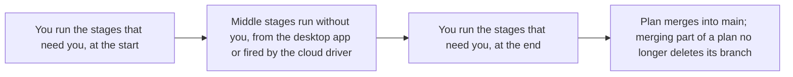
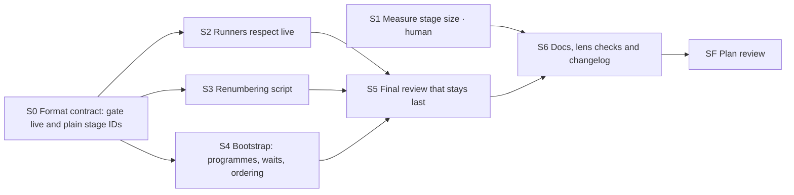

Generated from PLAN.md @ e018bff905ea — do not edit
# Milestones, live stages, plain numbers and a final review that stays last — plan brief

> One page to check this plan against what you expect. Feedback goes in chat
> (or as comments on the artifact): it is applied to `PLAN.md`, and this brief
> is regenerated from it.

## Outcome

*From `PLAN.md` › Requirements › Outcome.*

Long plans stay manageable. They can merge into `main` in parts, keep no multi-day waits inside, and say per stage whether it
touches only the repository or a live system, so repository-only stages run unattended and in parallel. They use plain numbers
in running order and always end on a review that is really last. The plan also produces a measured decision on how big a stage
should be.

## Day to day

*From `PLAN.md` › Requirements › Day to day.*

## Constraints and out of scope

*From `PLAN.md` › Requirements › Constraints and Out of scope.*

**Constraints, ranked:**

1. No existing safety rule loosens: no merge without a yes, never push to `main`, never touch `release` or the plugin version.
2. Plans already in flight keep running.
3. One source of truth: no new field duplicating an existing record.
4. Planning overhead stays small.

**Out of scope:** how stages are started locally (#222, #223, #185); estimates (#228); plan health (#229); the planning
changes of #226 (landed in #240); any release or version bump.

## Decisions

*From `PLAN.md` › Frozen decisions and Plan review.*

| ID | Decision | Group | Status |
|---|---|---|---|
| D-1 | A programme of plans is proposed when the requirements hold two or more outcomes that can each merge into `main` alone | Needs you | Answered |
| D-2 | A milestone is its own plan and merges by closing that plan; no mid-plan merge, so no branch-deletion guard | Needs you | Answered |
| D-3 | New `gate: live` for stages that change a running system; runners fire only `auto` or absent gates, and starting a second live stage is refused | Needs you | Answered |
| D-4 | Final review adds no stages, except up to 3 user-approved fixes; SF's PR lands the fix row, then SF re-runs; unattended it records a block | Needs you | Answered |
| D-5 | A `human` stage measures past sessions by script and shows its diff for your OK before the first push; only figures enter this public repo | Needs you | Answered |
| D-6 | A tracked `PROGRAMME.md` on `main` lists the programme's plans in order as pointers, with no state column | Needs you | Answered |
| D-7 | A wait measured in days becomes a dated follow-up stating the date, check, pass condition and action on failure; nothing is scheduled | Needs you | Answered |
| D-8 | Lasting decisions go to the existing root `DECISIONS.md` | Decided | The one clear target |
| D-9 | New stage IDs are plain numbers plus `SF`; existing suffixed IDs are still read | Decided | In-flight plans keep running |
| D-10 | A script renumbers only unstarted stages (no branch, not blocked); started or finished stages keep their number | Decided | Keeps history stable |
| D-11 | Stages that need the user come at the start and end | Decided | Extends the existing grouping rule to `live` |
| D-12 | A guard or alert that would wait on the plan branch is recommended as its own first plan or ticket | Decided | Protective changes should not wait |
| D-13 | A pass threshold states why that number and whether the check can detect the difference | Decided | One line in two places |
| D-14 | Stages run on Sonnet, the final review on Opus; where effort is arguable, take the higher | Decided | Standing cheaper-model rule |
| D-15 | S1 picks what makes a stage too big from its own figures | Default for now | Revisit when S1 closes |

**Plan review lenses (2026-10-27):** Simplicity — always; Architect — several components (templates, four commands, the
session-start hook, the remote driver) and a file-format change (stage index `gate`, stage-ID grammar); Operator — the
plugin's driver runs unattended and D-3/D-4 change what it fires and when it stops; Security — S1 reads local session
transcripts and its figures reach this public repo (turned on when the stage Artifacts were checked).

## Done when

*From `PLAN.md` › Requirements › Done.*

- [ ] `python3 scripts/validate_plugin.py` passes.
- [ ] The session-start hook lists the right runnable stages on a fixture plan with build and live stages.
- [ ] A fixture plan with a stage added mid-plan renumbers only unstarted stages and keeps SF last.
- [ ] Each "When this closes" item of #227 is walked and met (SF does this walk), namely:
  1. `/plan-stages` proposes a split into a programme above the threshold.
  2. A wait measured in days is not accepted as a stage; it becomes a dated follow-up.
  3. Every stage declares build or live, and only build stages run in parallel or unattended.
  4. Preflight warns about `delete_branch_on_merge` when milestone merges are in use, and names the fix.
  5. Stage IDs are plain numbers; a stage ID with a suffix is rejected.
  6. Stage numbers match running order at scaffold time and after any change to stages that haven't started.
  7. No stage is placed after the final review, and the final review adds no stages.
  8. Stages that need the user are grouped at the start and the end, as far as the dependencies allow.
  9. A decision on stage size is recorded with the measured figures it rests on.
  10. The docs are updated, and the changelog has an entry under `## [Unreleased]`.

## Stage map

*From `PLAN.md` › Stage index & dependencies.*

