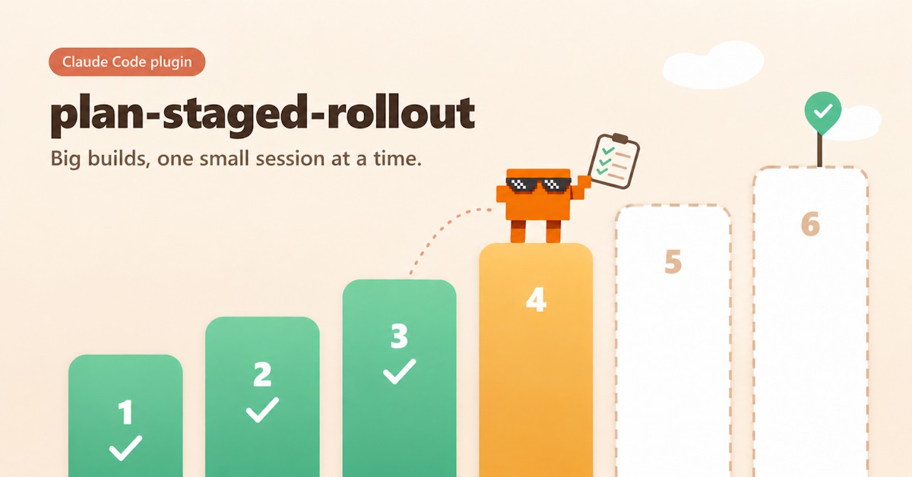
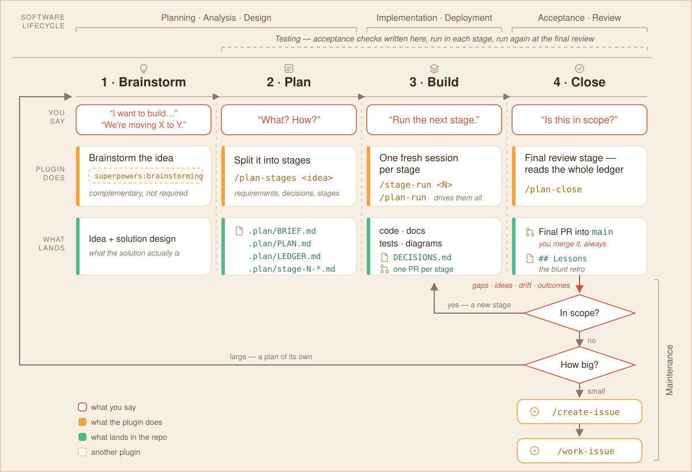

# Plan-Staged Rollout



**Run big projects as many small sessions — not one huge one.**

A Claude Code plugin. It splits a build too big for one session into small
**stages** and runs each stage in its own fresh session. A stage counts as
done only when its acceptance check has run, the output is recorded in
`LEDGER.md` (the plan's progress file in your repo), and its PR is merged.

It also includes two skills for single tickets: `create-issue` writes a
GitHub issue or Jira ticket, and `work-issue` has Claude work one. See
[Tickets](docs/tickets.md).

## Is it for me?

| Your situation | What to use |
|---|---|
| A build that needs **four or more sessions**, with parts that depend on each other | a **staged rollout** |
| Work you want to stop for days and pick up exactly where you left it | a **staged rollout** |
| One task that fits in **one to three sessions** | a **ticket**: `create-issue`, then `work-issue` |
| **A question you must answer before you can design** — a PoC, a spike | a **discovery plan**: it delivers the decision, not the prototype; the build is the next plan |
| **No settleable design at all** — every session would legitimately rewrite the decisions | neither, for now |

**What it costs you:** one planning session on an Opus-class model, then one
session per stage, each on the model its stage recommends. The example plan
below has three stages plus a review; the
[pilot rollout](docs/why.md#provenance) had eight.

## How a plan runs

[](docs/diagrams/how-it-works.svg)

The bottom row is the part people ask about first: **what the plugin produces
lands in your repo, not in a chat log** — the plan and its ledger, the code,
the docs, the tests, the decisions, and a blunt retro at the end.

- **Each stage gets a fresh session**, so a stage costs about the same
  however many came before it.
- **Each stage is its own branch and pull request (PR)** into a plan branch
  (`plan-<slug>`, which lives until the plan is closed).
  `main` is not touched until the final PR, and you merge that one yourself.
- **Everything is committed** in a `.plan/` folder in your repo. Close the
  laptop whenever you like: the next session reads where things stand.
- **Work with several milestones becomes a programme**: one plan per
  milestone, each closing into `main` on its own, listed in order in
  `PROGRAMME.md` at the repo root.
- **A stage that changes a running system is marked `gate: live`.** No
  unattended run fires it, and only one runs at a time.

What the progress file looks like halfway through (from the
[example plan](examples/uptime-page/.plan/LEDGER.md); `Verified` says whether
the acceptance check ran):

| Stage | Status | Verified | Date | Result |
|---|---|---|---|---|
| S0 Checker core | done | yes | 2026-07-08 | Checker + config parsing landed; PR #1 squash-merged |
| S1 CLI runner | doing | — | 2026-07-10 | Args + dispatch done; `--config` override and exit codes left (see notes) |
| S2 Status page | todo | — | — | — |
| SF Plan review | todo | — | — | — |

## Install

**Needs:** Claude Code (the CLI, or the desktop app's **Code** tab), and a git
repo on GitHub with the `gh` CLI signed in.

**CLI:**

```bash
claude plugin marketplace add by-carlos/plan-staged-rollout
claude plugin install plan-staged-rollout@plan-staged-rollout
```

**Desktop app:** in the **Code** tab, click **+** next to the prompt box,
then **Plugins** → **Add**. Enter `by-carlos/plan-staged-rollout`, click
**Sync**, then click the **+** beside Plan-Staged Rollout to install it.

There is nothing to configure. Other routes, full requirements and updating:
[Install and update](docs/install.md).

## What this plugin installs

Besides its commands and skills, the plugin registers three hooks (small
scripts that Claude Code runs on its own at set moments). They are listed
here so nothing runs in your session without your knowing.

| Hook | Runs | What it does |
|---|---|---|
| **Session start** | When a session starts, or after `/clear` or a compaction | If the repo root has a `.plan/` folder holding both `LEDGER.md` and `PLAN.md`, it adds one short plain-text note to the session: which stages can run now, each with its recommended model and effort and the command to run it. The note tells Claude to *offer* the next step and wait for you, never to start it. With no such `.plan/` it prints nothing. It reads only your own plan files (and asks git for the repo root), makes no network call, and always exits quietly. |
| **`gh-body-guard`** | Before each `Bash` command | Denies `gh issue` or `gh pr` `create`, `comment` and `edit` when the body comes from `--body-file`, `-F` or `--body "@path"`, which post a garbled or literal-path body. The denial says why and names the plugin's adapter as the alternative. Any other command is left alone. |
| **`tracker-write-guard`** | Before each `Bash` command and each Jira create or write tool call | Does nothing unless you set `guard_tracker_creates = true` in `plan-staged-rollout.toml`. With it on, it denies a ticket create that did not come through `create-issue`. |

Both guards only ever *deny* or stay silent; they never approve a command, so
your own permission rules still apply to everything. If Python 3.11 or later
or `bash` is missing, they step aside and the command runs as if they were not
there. Requirements per part are in the
[prerequisites table](docs/install.md#where-it-runs).

**Data.** The plugin collects no personal data, sends nothing anywhere of its
own, and keeps nothing outside your repository (`.plan/`) and your machine.
The ticket skills write to GitHub through your own signed-in `gh`, and to Jira
through the Atlassian tools you have connected yourself.

## Try it

1. Open a session in a repo that has a big job to do.
2. Run `/plan-staged-rollout:plan-stages <your idea>`. It plays your
   requirements back for you to confirm, asks its open design questions in
   one batch, splits the work into stages, writes a one-page brief
   (`.plan/BRIEF.md`) and reviews the plan before committing `.plan/`.
   **It does not run any stage.**
3. Open a **new** session. It lists the stages that can run now; say yes to
   one. (If it says nothing, run `/plan-staged-rollout:stage-run 0`.) When
   the stage finishes, it opens a PR into the plan branch and offers to merge
   it: say yes.
4. Repeat step 3 until every stage is done, including the final review
   stage, which asks you once which of the plan's decisions to keep and
   writes them to `DECISIONS.md` so they outlive `.plan/`. Then run
   `/plan-staged-rollout:plan-close`; it proposes the final PR into `main`,
   and you merge it.

## Commands and skills

All commands start with `/plan-staged-rollout:`. Each also starts from plain
language once the plugin is installed.

| To… | Command | Or say |
|---|---|---|
| Split a project into stages | `plan-stages <idea>` | "break this project into stages" |
| Run one stage in this session | `stage-run <N>` | "run stage 2", "run the next stage" |
| Run every remaining stage in the cloud, instead of one by one (the plan needs `merge: auto`) | `plan-run` | "run the plan" |
| Finish the plan and propose the final PR | `plan-close` | "close the plan" |
| Write one ticket | `create-issue` | "create an issue for …" |
| Have Claude work one ticket | `work-issue <ticket>` | "work issue 124" |

## Documentation

| Page | Read it when |
|---|---|
| [Install and update](docs/install.md) | you install, update, or can't find the plugin |
| [How a staged rollout works](docs/staged-rollout.md) | before your first plan: the steps, branches, review and close |
| [Running a plan in the cloud](docs/ON-THE-RUN.md) | you want stages to run without opening each session yourself |
| [Tickets](docs/tickets.md) | you want to use `create-issue` or `work-issue` |
| [Customizing the ticket template](docs/ticket-templates.md) | your team's tickets follow their own format |
| [FAQ](docs/faq.md) | is my plan saved? How do I resume, skip, undo or abandon? |
| [Reference](docs/reference.md) | you want every flag, status and `.plan/` file |
| [Why staged rollouts](docs/why.md) | you want the problem it solves, when not to use it, and how it compares |
| [Pairing with superpowers brainstorming](docs/superpowers-brainstorming.md) | you brainstorm designs with the superpowers plugin and want to know what to do with its spec |
| [Single session or many](docs/single-vs-multi-session.md) | you are deciding between one long session and a staged rollout |

## Contributing

See [CONTRIBUTING.md](CONTRIBUTING.md). [CHANGELOG.md](CHANGELOG.md) lists what
shipped when.

## Author

Built by **Carlos Eng** —
[GitHub](https://github.com/by-carlos) ·
[LinkedIn](https://www.linkedin.com/in/carlos-eng/)

## License

[FSL-1.1-ALv2](LICENSE) © Carlos Eng — free for any use except building a
competing commercial product.
