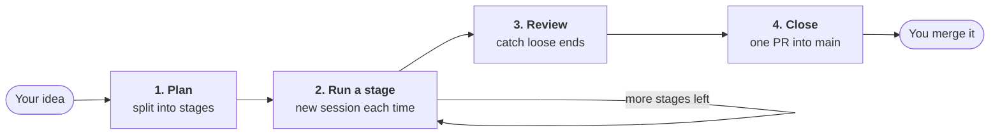

# Plan-Staged Rollout


**Run big projects as many small sessions — not one huge one.**

A Claude Code plugin. It splits a build too big for one session into small
**stages** and runs each stage in its own fresh session. A stage counts as
done only when its acceptance check has run, the output is recorded in
`LEDGER.md` (the plan's progress file in your repo), and its PR is merged.

It also includes two skills for single tickets: `create-issue` writes a
GitHub issue or Jira ticket, and `work-issue` has Claude work one. See
[Tickets](docs/tickets.md).

## Is it for me?

| Your situation | What to use |
|---|---|
| A build that needs **four or more sessions**, with parts that depend on each other | a **staged rollout** |
| Work you want to stop for days and pick up exactly where you left it | a **staged rollout** |
| One task that fits in **one to three sessions** | a **ticket**: `create-issue`, then `work-issue` |
| Exploring, with no design you could write down yet | neither, for now |

**What it costs you:** one planning session on an Opus-class model, then one
session per stage, each on the model its stage recommends. The example plan
below has three stages plus a review; the
[pilot rollout](docs/why.md#provenance) had eight.

## How a plan runs



- **Each stage gets a fresh session**, so a stage costs about the same
  however many came before it.
- **Each stage is its own branch and pull request (PR)** into a plan branch
  (`plan-<slug>`, which lives until the plan is closed).
  `main` is not touched until the final PR, and you merge that one yourself.
- **Everything is committed** in a `.plan/` folder in your repo. Close the
  laptop whenever you like: the next session reads where things stand.

What the progress file looks like halfway through (from the
[example plan](examples/uptime-page/.plan/LEDGER.md); `Verified` says whether
the acceptance check ran):

| Stage | Status | Verified | Date | Result |
|---|---|---|---|---|
| S0 Checker core | done | yes | 2026-07-08 | Checker + config parsing landed; PR #1 squash-merged |
| S1 CLI runner | doing | — | 2026-07-10 | Args + dispatch done; `--config` override and exit codes left (see notes) |
| S2 Status page | todo | — | — | — |
| SF Plan review | todo | — | — | — |

## Install

**Needs:** Claude Code (the CLI, or the desktop app's **Code** tab), and a git
repo on GitHub with the `gh` CLI signed in.

**CLI:**

```bash
claude plugin marketplace add by-carlos/plan-staged-rollout
claude plugin install plan-staged-rollout@plan-staged-rollout
```

**Desktop app:** in the **Code** tab, click **+** next to the prompt box,
then **Plugins** → **Add**. Enter `by-carlos/plan-staged-rollout`, click
**Sync**, then click the **+** beside Plan-Staged Rollout to install it.

There is nothing to configure. Other routes, full requirements and updating:
[Install and update](docs/install.md).

## Try it

1. Open a session in a repo that has a big job to do.
2. Run `/plan-staged-rollout:plan-stages <your idea>`. It asks about the
   design, splits the work into stages and commits `.plan/`. **It does not
   run any stage.**
3. Open a **new** session. It lists the stages that can run now; say yes to
   one. (If it says nothing, run `/plan-staged-rollout:stage-run 0`.) When
   the stage finishes, it opens a PR into the plan branch and offers to merge
   it: say yes.
4. Repeat step 3 until every stage is done, including the final review
   stage. Then run `/plan-staged-rollout:plan-close`; it proposes the final
   PR into `main`, and you merge it.

## Commands and skills

All commands start with `/plan-staged-rollout:`. Each also starts from plain
language once the plugin is installed.

| To… | Command | Or say |
|---|---|---|
| Split a project into stages | `plan-stages <idea>` | "break this project into stages" |
| Run one stage in this session | `stage-run <N>` | "run stage 2", "run the next stage" |
| Run every remaining stage in the cloud, instead of one by one (the plan needs `merge: auto`) | `plan-run` | "run the plan" |
| Finish the plan and propose the final PR | `plan-close` | "close the plan" |
| Write one ticket | `create-issue` | "create an issue for …" |
| Have Claude work one ticket | `work-issue <ticket>` | "work issue 124" |

## Documentation

| Page | Read it when |
|---|---|
| [Install and update](docs/install.md) | you install, update, or can't find the plugin |
| [How a staged rollout works](docs/staged-rollout.md) | before your first plan: the steps, branches, review and close |
| [Running a plan in the cloud](docs/ON-THE-RUN.md) | you want stages to run without opening each session yourself |
| [Tickets](docs/tickets.md) | you want to use `create-issue` or `work-issue` |
| [Customizing the ticket template](docs/ticket-templates.md) | your team's tickets follow their own format |
| [FAQ](docs/faq.md) | is my plan saved? How do I resume, skip, undo or abandon? |
| [Reference](docs/reference.md) | you want every flag, status and `.plan/` file |
| [Why staged rollouts](docs/why.md) | you want the problem it solves, when not to use it, and how it compares |

## Contributing

See [CONTRIBUTING.md](CONTRIBUTING.md). [CHANGELOG.md](CHANGELOG.md) lists what
shipped when.

## Author

Built by **Carlos Eng** —
[GitHub](https://github.com/by-carlos) ·
[LinkedIn](https://www.linkedin.com/in/carlos-eng/)

## License

[FSL-1.1-ALv2](LICENSE) © Carlos Eng — free for any use except building a
competing commercial product, and each release becomes Apache-2.0 two years
after it is made available. Versions before 0.6.0 remain MIT.
