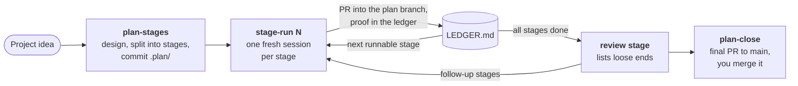

# Plan-Staged Rollout


**Run big projects as many small sessions — not one huge one.**

A Claude Code plugin. It splits a build that is too big for one session into
small **stages**. Each stage runs in its own fresh session, and records proof
that it works before the stages that depend on it start. For smaller work, it
also has two skills: one writes a GitHub issue or Jira ticket, and the other
has Claude work one.

## Is it for me?

| Your situation | What to use |
|---|---|
| A build that needs **four or more sessions**, with parts that depend on each other | a **staged rollout** |
| Work you want to stop for days and pick up exactly where you left it | a **staged rollout** |
| One task that fits in **one to three sessions** | a **ticket**: `create-issue`, then `work-issue` |
| Exploring, with no design you could write down yet | neither, for now |

## How a plan runs



- **A fresh session for each stage.** A stage reads the plan, its own stage
  file and the ledger, never the whole history, so the cost of each stage
  stays flat however many came before it.
- **One branch and one pull request (PR) per stage**, merged into a plan
  branch. `main` is not touched until the final PR, and you merge that one
  yourself.
- **A stage is done when its check has run** and the output is pasted into
  `LEDGER.md`. The model saying it finished is not enough.
- **The whole plan is committed** in a `.plan/` folder in your repo. Close
  the laptop whenever you like: the next session reads where things stand.

## Install

**Desktop app** (the **Code** tab): click **+** next to the prompt box,
choose **Plugins**, then **Add**. Enter `by-carlos/plan-staged-rollout` and
click **Sync**. Then click the **+** next to Plan-Staged Rollout.

**CLI:**

```bash
claude plugin marketplace add by-carlos/plan-staged-rollout
claude plugin install plan-staged-rollout@plan-staged-rollout
```

There is nothing to configure. For other install routes, requirements and
updating, see [Install and update](docs/install.md).

## Try it

1. Open a session in a repo that has a big job to do.
2. Run `/plan-staged-rollout:plan-stages <your idea>`. It asks about the
   design, splits the work into stages and commits `.plan/`. **It does not
   run any stage.**
3. Open a **new** session. It tells you which stage is next. Say yes.
4. Repeat step 3 until every stage is done, then run
   `/plan-staged-rollout:plan-close`.

To see a plan before you make one, [`examples/uptime-page/`](examples/) is a
real `.plan/` captured halfway through a rollout.

## Commands and skills

Each one starts from its slash command, or from plain language once the
plugin is installed.

| To… | Type | Or say |
|---|---|---|
| Split a project into stages | `/plan-staged-rollout:plan-stages <idea>` | "break this project into stages" |
| Run one stage in this session | `/plan-staged-rollout:stage-run <N>` | "run stage 2", "run the next stage" |
| Run every remaining stage in the cloud | `/plan-staged-rollout:plan-run` | "run the plan" |
| Finish the plan and open the final PR | `/plan-staged-rollout:plan-close` | "close the plan" |
| Write one ticket | `/plan-staged-rollout:create-issue` | "create an issue for …" |
| Have Claude work one ticket | `/plan-staged-rollout:work-issue <ticket>` | "work issue 124" |

## Documentation

| Page | Read it when |
|---|---|
| [Install and update](docs/install.md) | you install, update, or can't find the plugin |
| [How a staged rollout works](docs/staged-rollout.md) | before your first plan: the steps, branches, review and closeout |
| [Running a plan in the cloud](docs/ON-THE-RUN.md) | you want stages to run without opening each session yourself |
| [Tickets](docs/tickets.md) | you want to use `create-issue` or `work-issue` |
| [Customizing the ticket template](docs/ticket-templates.md) | your team's tickets follow their own format |
| [FAQ](docs/faq.md) | is my plan saved? How do I resume, skip, undo or stop? |
| [Reference](docs/reference.md) | you want every flag, status and `.plan/` file |
| [Why staged rollouts](docs/why.md) | you want the problem it solves and how it compares |

## Contributing

See [CONTRIBUTING.md](CONTRIBUTING.md). [CHANGELOG.md](CHANGELOG.md) lists what
shipped when.

## Author

Built by **Carlos Eng** —
[GitHub](https://github.com/by-carlos) ·
[LinkedIn](https://www.linkedin.com/in/carlos-eng/)

## License

[FSL-1.1-ALv2](LICENSE) © Carlos Eng — free for any use except building a
competing commercial product, and each release becomes Apache-2.0 two years
after it is made available. Versions released before this change remain MIT.
