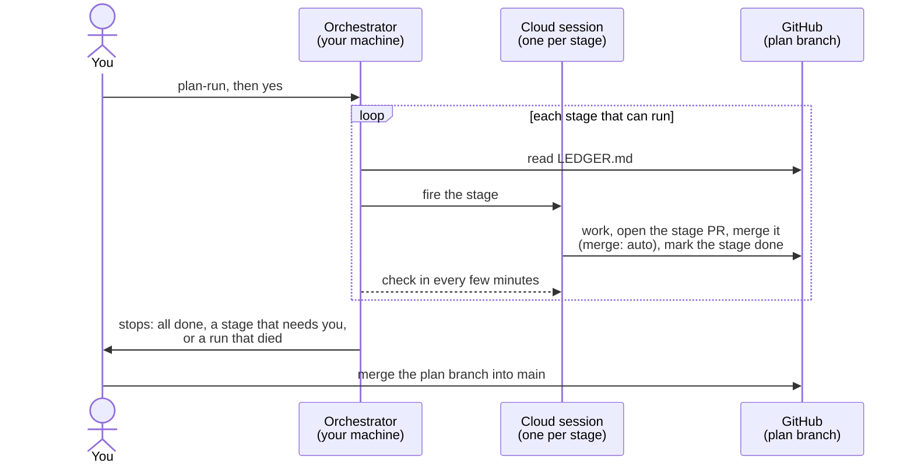

# Running a plan in the cloud — `plan-run`

[Home](../README.md) · [Install](install.md) · [How it works](staged-rollout.md) · **Cloud runs** · [Tickets](tickets.md) · [Ticket template](ticket-templates.md) · [FAQ](faq.md) · [Reference](reference.md) · [Why](why.md)

**In short:** instead of opening a new session for every stage, keep one
local session open (the **orchestrator**) and run `plan-run`. It fires each
remaining stage as its own cloud session against your GitHub repo, one after
another, so a whole build can run while you watch from your phone. The
computer running the orchestrator has to stay on, and the final merge into
`main` is always yours.

## What it does

You run `plan-run` in one local Claude Code session, in a clone of your
repository. From there:

1. It reads `.plan/LEDGER.md` on the plan branch to work out which stage can
   run next.
2. It fires that stage as a cloud session, using Claude Code's built-in
   `RemoteTrigger` tool. No script, no credential to set up.
3. The cloud session runs the stage on its own: writes the code, opens a pull
   request, and records `done` (or `blocked`) in the ledger. Under the plan
   flag **`merge: auto`** it also squash-merges the stage PR into the plan
   branch once checks are green. Under `merge: manual` it leaves the PR open
   for you and the row at `doing`, so a plan meant to run unattended should
   set `merge: auto`.
4. The orchestrator checks in every few minutes, watching the run and
   re-reading the ledger, then fires the next stage that can run.

## What you need first

- **The plugin installed locally.** `plan-run` is a command in your local
  session, not something that runs by itself.
- **A plan on GitHub**, with `.plan/RUNNER.md` in it. `plan-stages` creates
  and pushes the plan branch `plan-<slug>`; check it is on GitHub before you
  start. New plans get `RUNNER.md` automatically; an older plan gets it
  backfilled from the plugin's template before its first cloud run.
- **`merge: auto`** on the plan flags line in `PLAN.md`, if you want stages to
  run one after another without you (see [Plan flags](reference.md#plan-flags)).
- **Cloud access on your Claude account.** `RemoteTrigger` very likely needs
  it (not yet checked across account types).
- **GitHub connected to claude.ai/code for this repository**, so a cloud
  session can clone it and open pull requests through the GitHub MCP server.

## Running it

Type `/plan-staged-rollout:plan-run` in your local session. Before touching
anything it shows a plain-language notice and waits for a yes, because it is
a much bigger action than `stage-run` and shares part of its name. The notice
says that:

- it runs *every* remaining stage in the cloud, not just one;
- a cloud stage can't reach anything only your machine has;
- each fired stage is a separate cloud session that may use additional
  credits (see
  [Claude Code on the web](https://code.claude.com/docs/en/claude-code-on-the-web)).

Say yes, and it starts firing.

While it runs, your local session prints which stage it fired, the cloud
session's link, and its status each time it checks in. You don't have to
watch: leave the terminal open and come back to it. Each fired stage is an
ordinary cloud session; open its link at [claude.ai/code](https://claude.ai/code)
on desktop or in the phone app to watch it or read its log.

It stops when:

- every stage is `done` or `skipped` (it tells you so);
- it reaches a `gate: human` or `gate: local` stage, or a dependency that
  isn't ready; or
- a run died (see below).

Either way, merging the plan branch into `main` is left to you. To carry on
after a stop, run `plan-run` again.

## What a cloud stage can't reach

A fired stage runs in a sandbox with no path back to your machine: no LAN, no
local files outside the clone, no local services, nothing you have installed
but not committed to the repo. That's what `gate: local` is for: mark a stage
that needs something only your machine has, and the orchestrator skips it and
tells you to run it yourself.

## When a stage is reported dead or blocked

- **Blocked** means the ledger says so: a `gate: human` or `gate: local`
  stage, or a row the stage itself marked `blocked` with a note. Read the
  note, fix or run what it needs, then run `plan-run` again.
- **Dead** means the cloud run ended but the ledger row never moved, even
  after the orchestrator's grace period. The orchestrator reports the session
  id, its claude.ai link, what its log showed, and whether the stage branch or
  its pull request exist on GitHub. It never writes to the plan branch on the
  stage's behalf. You decide: fire the stage again, fix it by hand, or run it
  in a normal local session.

## Known limits

| Limit | What it means for you |
|---|---|
| **Effort isn't booked.** `RemoteTrigger` books a stage's `model` but has no measured way to book its `effort`, so the effort is only restated in the fired prompt. In the proof run below, no fired stage actually read `CLAUDE_EFFORT`; each took the value from its own prompt. | Treat a cloud stage's effort as requested, not confirmed. |
| **Spent routines stay listed.** Each fire leaves a used-up routine that switches itself off but can't be deleted through the API. | Clear them out at claude.ai/code/routines once a plan finishes. |
| **A cloud run can't delete remote branches** (the git proxy refuses with 403). | Merged stage branches linger on GitHub until you delete them. |
| **No worktrees.** Nothing outside the primary clone persists between tool calls, so a sibling worktree could vanish mid-stage. | A cloud run uses one branch per stage, without a worktree per stage. |
| **The branch name may look wrong.** The checkout's content is the plan branch, but its HEAD may show a platform-named branch. | Expected; the stage prompt tells the session so. |
| **Cloud access is a likely requirement, not a measured one.** | If `plan-run` can't fire, check that cloud sessions work on your account. |
| **Proven once, on a small plan** (see below). | A long plan with slow stages is still unmeasured. |

**The proof run** ([#168](https://github.com/by-carlos/plan-staged-rollout/issues/168),
25 Sep 2026): a four-stage plan ran to completion on a disposable repo.

- **What worked:** two dependent `gate: auto` stages fired and settled `done`
  without a person (2 and 4 minutes each); the `gate: human` stage was
  refused and run by hand; the unattended `plan-close` passed its
  verification script 43/43; and the hand-made merge into `main` kept every
  stage as its own commit.
- **What it left behind:** four spent routines and three merged stage
  branches to clear by hand.
- **Two gaps, both fixed since:** the fired prompt must spell out the
  plan-branch checkout (a Sonnet stage told only "per `.plan/RUNNER.md`"
  looked at the default branch, found no plan and gave up); and a finished
  run keeps `status: active`, so the end signal is `worker_status: idle`.
- **Not observed:** a dead run past the grace period, or any grace-period
  behaviour beyond that one failed fire.

## Under the hood

The orchestrator is an ordinary interactive Claude Code session running
`plan-run` with no arguments. Each fired stage is a first-class session at
claude.ai/code that you can open, watch and resume. Close the laptop and the
stage already fired runs to its end, but nothing fires the next one. The full
command is [`commands/plan-run.md`](../commands/plan-run.md).

It fires stages through **`RemoteTrigger`**, a tool built into Claude Code
that talks to the claude.ai routines API with your account's own
authentication. For each stage it:

1. creates a run-once routine to hold the stage's settings: the repository,
   the stage prompt, and the stage's `model` from the index;
2. fires it directly with the tool's `run` action (the schedule is never
   involved), and gets the new session's id and link back straight away;
3. polls the run's condensed log to see it finish, fail or crash before
   firing the next.

Its guarantees:

- **`gate: human` and `gate: local` stages are never fired.** A cloud session
  has strictly less access than your machine.
- **Dependencies must read `done` or `skipped` in the ledger** before a stage
  fires. Firing out of order is a deliberate choice by you, never a default.
- **It refuses to run from a protected branch** (such as `main`), and **the
  merge into `main` is always done by a person.**
- **The ledger is the only state.** Stop whenever you like and pick the plan
  up later, from this or any other session.

**Plugins don't load in cloud sessions**, so a fired session has no
`stage-run` to call. It doesn't need one: `.plan/RUNNER.md`, scaffolded by
`plan-stages`, tells a cold session how to run one stage, and `.plan/PLAN.md`
carries the operating protocol it follows. The fired prompt tells the session
to check out the plan branch and follow them, which is why the plan branch
must be on GitHub before anything fires.

**Designs tried before:** one hand-made cloud routine per model in the stage
table; and a Python script posting directly to the session-creation API,
which meant hand-maintaining an OAuth credential that a public plugin should
not ship. `claude --cloud` was rejected because it needs an interactive
terminal and can't be called from a session. The current guarantees carry
over from those earlier designs unchanged.

## If you want the details

- [`remote-driver.md`](../skills/staged-rollout/references/remote-driver.md) —
  the authoritative contract: the fired prompt's shape, the exact
  `RemoteTrigger` calls, the poll cadence, the dead-run definition, every
  refusal, and what is measured and what is still open.
- [`.plan/RUNNER.md`](../skills/staged-rollout/references/templates/RUNNER.md) —
  what a fired cloud session follows to run its one stage.
- [`examples/on-the-run/`](../examples/on-the-run/) — retired prompt
  contracts from the earlier routine-based design, kept only so old links
  resolve.
