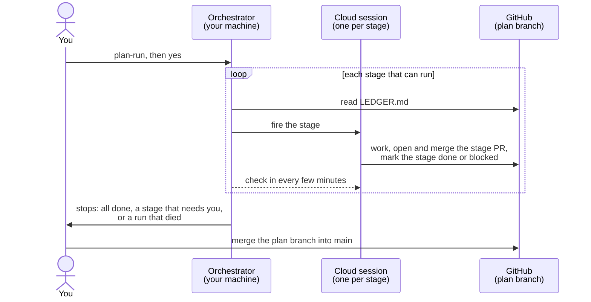

# Running a plan in the cloud — `plan-run`

[Home](../README.md) · [Install](install.md) · [Staged rollout](staged-rollout.md) ·
**Cloud runs** · [Tickets](tickets.md) · [FAQ](faq.md) ·
[Reference](reference.md)

**In short:** instead of opening a new session for every stage, keep one
local session open (the **orchestrator**) and run `plan-run`. It fires each
remaining stage as its own cloud session against your GitHub repo, one after
another, so a whole build can run while you watch from your phone. The
computer running the orchestrator still has to stay on, and the final merge
into `main` is still yours.

## What it does

You run `plan-run` in one local Claude Code session, in a clone of your
repository. From there:

1. It reads `.plan/LEDGER.md` on the plan branch to work out which stage can
   run next.
2. It fires that stage as a cloud session, using Claude Code's built-in
   `RemoteTrigger` tool. No script, no credential to set up.
3. The cloud session runs the stage on its own: writes the code, opens a pull
   request, merges it into the plan branch, and records `done` (or `blocked`)
   in the ledger. Nothing it does needs you.
4. The orchestrator checks in every few minutes, watching the run and
   re-reading the ledger, then fires the next stage that can run.

It stops when nothing is left to run, when a stage needs a person, or when a
run goes dead. The last merge, plan branch into `main`, is always yours.

## What you need first

- **The plugin installed locally.** `plan-run` is a command in your local
  session, not something that runs by itself.
- **A plan already pushed to GitHub**, with `.plan/RUNNER.md` in it. Make the
  plan the usual way with `plan-stages` on the branch `plan-<slug>`, and push
  it. New plans get `RUNNER.md` automatically; an older plan gets it
  backfilled from the plugin's template before its first cloud run.
- **Cloud access enabled on your Claude account.** `RemoteTrigger` needs it:
  no claude.ai/code cloud, no cloud runs.
- **GitHub connected to claude.ai/code for this repository**, so a cloud
  session can clone it and open pull requests through the GitHub MCP server.

## Running it

Type `/plan-staged-rollout:plan-run` in your local session. Before touching
anything it shows a plain-language notice and waits for a yes, because it is
a much bigger action than `stage-run` and shares part of its name. The notice
says that:

- it runs *every* remaining stage in the cloud, not just one;
- a cloud stage can't reach anything only your machine has;
- each fired stage is a separate cloud session that may use additional
  credits (see
  [Claude Code on the web](https://code.claude.com/docs/en/claude-code-on-the-web)).

Say yes, and it starts firing.

While it runs, your local session prints what it's doing: which stage it
fired, the cloud session's link, and its status each time it checks in. You
don't have to watch: leave the terminal open and come back to it.

Each fired stage is an ordinary cloud session. Open the link the orchestrator
prints, at [claude.ai/code](https://claude.ai/code) on desktop or in the
phone app, to watch it work or read its log. It is just another session in
your account's list.

It ends one of two ways. Either every stage is `done` or `skipped` and it
tells you so, or it reaches a `gate: human` or `gate: local` stage, a
dependency that isn't ready, or a dead run, and stops in front of it. Either
way, merging the plan branch into `main` is left to you.

## What a cloud stage can't reach

A fired stage runs in a sandbox with no path back to your machine: no LAN, no
local files outside the clone, no local services, nothing you have installed
but not committed to the repo. That's what `gate: local` is for: mark a stage
that needs something only your machine has, and the orchestrator skips it and
tells you to run it yourself.

## When a stage is reported dead or blocked

- **Blocked** means the ledger says so: a `gate: human` or `gate: local`
  stage, or a row the stage itself marked `blocked` with a note. Read the
  note, fix or run what it needs, then run `plan-run` again to pick up from
  there.
- **Dead** means the cloud run ended but the ledger row never moved, even
  after the orchestrator's grace period. The orchestrator reports the session
  id, its claude.ai link, what its log showed, and whether the stage branch or
  its pull request exist on the remote. It never writes to the plan branch on
  the stage's behalf. You decide what happens next: fire the stage again, fix
  it by hand, or open a normal local session for it.

## Known limits

- **Reasoning effort isn't booked.** `RemoteTrigger` books a stage's `model`
  but has no measured way to book its `effort`, so the `effort` column is
  restated in the fired prompt rather than set. The fired stage is meant to
  read the effort it actually got from `CLAUDE_EFFORT` and block on a
  mismatch, but in the 25 Sep 2026 end-to-end run no fired stage read it:
  each reported "effort matches" by taking the value from its own prompt.
  Treat a cloud stage's effort as requested, not confirmed.
- **Spent routines aren't cleaned up automatically.** Each fire leaves a
  used-up routine behind. They switch themselves off but stay listed, and the
  API can't delete them: clear them out at claude.ai/code/routines once a plan
  finishes.
- **A cloud run can't delete remote branches** (403 from the git proxy), so
  merged stage branches linger on the remote until someone deletes them.
- **No path persists outside the primary clone between tool calls**, so a
  sibling worktree can vanish mid-stage. A cloud run therefore uses one
  branch per stage rather than one worktree per stage.
- **The branch name may look wrong.** A fired stage runs from a checkout whose
  *content* is the plan branch but whose HEAD may show a platform-named
  branch. The stage prompt tells the session this is expected.
- **Cloud access on the account is a likely prerequisite, not a measured
  one.** `RemoteTrigger`'s availability probably tracks it, but that hasn't
  been checked across account types.
- **Proven end to end once, on a small fixture** (25 Sep 2026, #168). A
  four-stage plan ran to completion on a disposable repo: two dependent auto
  stages fired and settled `done` without a person (2 and 4 minutes each),
  the `gate: human` stage was refused and run by hand, the auto closeout
  passed its verification script 43/43, and the hand-made plan→main merge
  left every stage as its own commits on `main`. Four cloud sessions were
  fired, leaving four spent routines and three merged stage branches to
  clear by hand. Two gaps surfaced and are fixed in the contract: the fired
  prompt must spell out the plan-branch checkout (a Sonnet stage told only
  "per `.plan/RUNNER.md`" looked at the default branch, found no plan and
  gave up), and a finished run keeps `status: active` — the end signal is
  `worker_status: idle`. No dead run past the grace period and no
  grace-period behaviour were observed beyond that one failed fire. One
  small plan is one data point: a long plan with slow stages is still
  unmeasured.

## Under the hood

The orchestrator is an ordinary interactive Claude Code session in a clone of
your repo, running `plan-run` with no arguments. It moves every *remaining*
stage off your machine, not just the next one. Each fired stage is a
first-class session at claude.ai/code that you can open, watch and resume.
The orchestrator itself stays local, so the machine running it has to stay
on: close the laptop and the stage already fired runs to its end, but nothing
fires the next one. The full command is
[`commands/plan-run.md`](../commands/plan-run.md).

There is nothing to install and no credential to manage. It fires stages
through **`RemoteTrigger`**, a tool built into Claude Code that talks to the
claude.ai routines API, with your account's own authentication handled
in-process. For each stage it:

1. creates a run-once routine to hold the stage's settings: the repository,
   the stage prompt, and the stage's `model` from the index;
2. fires it directly with the tool's `run` action (the schedule is never
   involved), and gets the new session's id and link back straight away;
3. polls the run's condensed log to see it finish, fail or crash before
   firing the next.

The guarantees, which carry over unchanged from the retired local driver:

- **`gate: human` and `gate: local` stages are never fired.** A cloud
  container has strictly less access than your machine, so the orchestrator
  stops in front of them.
- **Dependencies must read `done` or `skipped` in the ledger** before a stage
  fires. Firing out of order is a deliberate operator choice, never a
  default.
- **It refuses to drive from a protected branch**, and **the plan→main merge
  stays manual and done by a person in every mode.**
- **The ledger is the only state.** Stop driving whenever you like and pick
  the plan up later, from this or any other session, from what is written
  down.

**Plugins do not load in cloud containers**, so a fired session has no
`plan-run` or `stage-run` to call. It doesn't need one: the plan carries its
own instructions. `.plan/RUNNER.md`, scaffolded by `plan-stages`, tells a
cold session how to run one stage, and `.plan/PLAN.md` carries the operating
protocol it defers to. The fired prompt is a short instruction to check out
the plan branch and follow them, which is why the plan branch must be pushed
before anything fires. A plan made before `RUNNER.md` existed gets it
backfilled from the plugin's templates (see
[`remote-driver.md`](../skills/staged-rollout/references/remote-driver.md)).

## What was tried before

Two earlier designs didn't make it into the current one: hand-provisioning
one cloud routine per model named in the stage table, and driving stages with
a Python script posting directly to the session-creation API (no native tool,
and it meant hand-maintaining an OAuth credential, which a public plugin
should not ship). `claude --cloud` was also considered and rejected: it needs
an interactive terminal and can't be scripted or called from a session.

## If you want the details

- [`remote-driver.md`](../skills/staged-rollout/references/remote-driver.md) —
  the authoritative contract: the exact `RemoteTrigger` calls, the poll
  cadence, the dead-run definition, every refusal, and what is measured and
  what is still open.
- [`.plan/RUNNER.md`](../skills/staged-rollout/references/templates/RUNNER.md) —
  what a fired cloud session actually follows to run its one stage.
- [`examples/on-the-run/`](../examples/on-the-run/) — retired prompt
  contracts from the earlier routine-based design, kept only so old links
  resolve.
