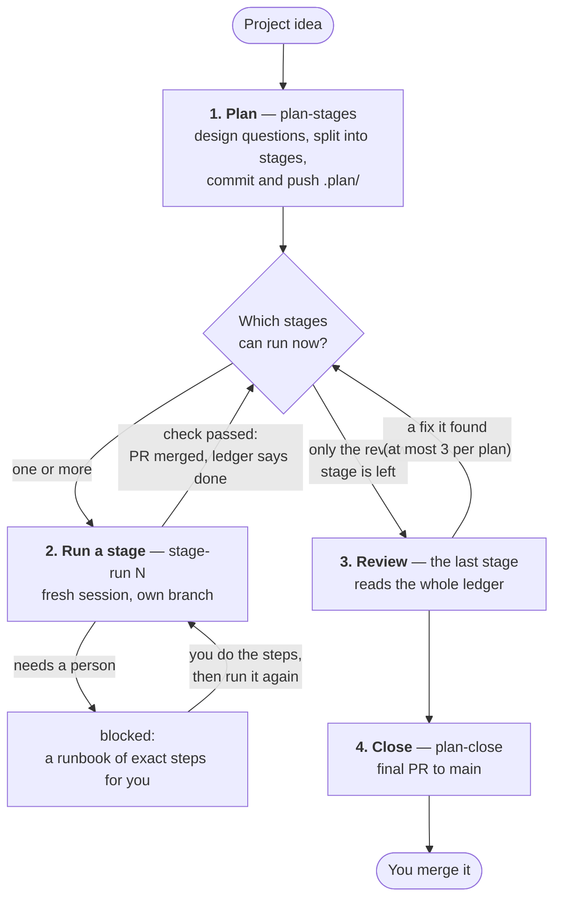
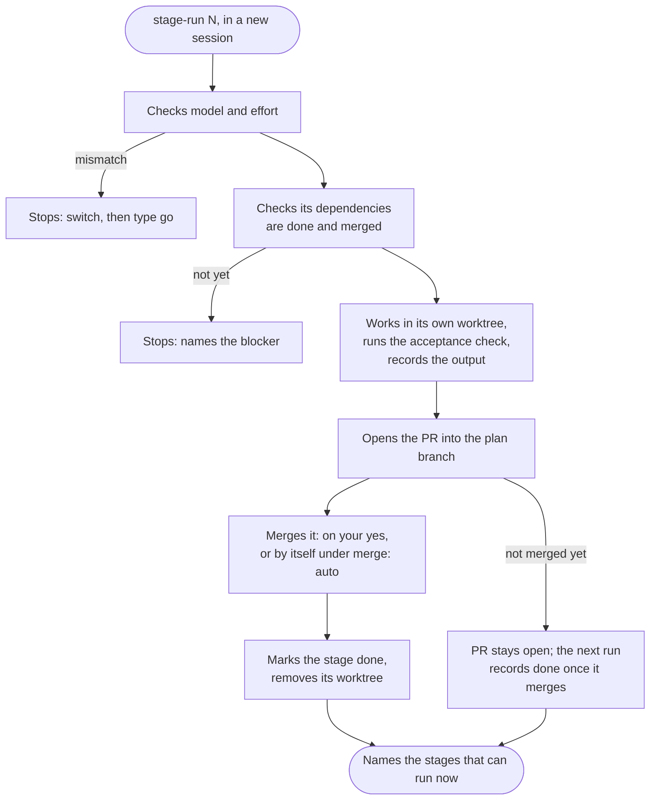
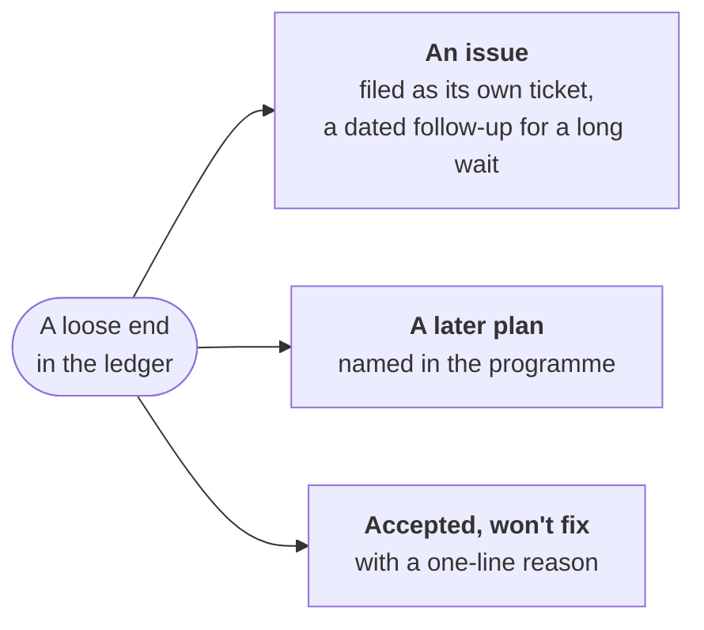
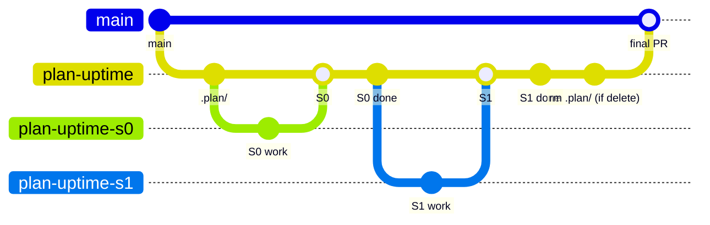
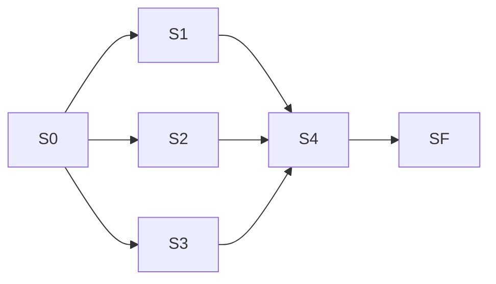

# How a staged rollout works

[Home](../README.md) · [Install](install.md) · **How it works** · [Cloud runs](ON-THE-RUN.md) · [Tickets](tickets.md) · [Ticket template](ticket-templates.md) · [FAQ](faq.md) · [Reference](reference.md) · [Why](why.md)

**In short:** plan once, run each stage in its own fresh session, review,
close. Every stage ends with a merged PR into the plan branch and proof in
the ledger; `plan-close` proposes the one PR into `main`, and you merge it.



| Step | Command | How often | What happens |
|---|---|---|---|
| 1. Plan | `plan-stages <idea>` | once | Settles the design, splits the work into stages, commits and pushes `.plan/`. Runs no stage. |
| 2. Run stages | `stage-run <N>` | once per stage, each in a new session | Does one stage, runs its acceptance check, records the output, opens its PR. |
| | `plan-run` | once, and again after each stop | Instead of `stage-run`: runs every remaining stage in the cloud. The plan needs `merge: auto`. See [Running a plan in the cloud](ON-THE-RUN.md). |
| 3. Review | `stage-run f` (f for final: stage `SF`) | once, last | Reads every note in the ledger and turns each loose end into a stage or a decision. |
| 4. Close | `plan-close` | once | Writes the final PR from the plan, cleans up and proposes the PR into `main`. |

Commands are shown by their short names; type them as
`/plan-staged-rollout:<name>`.

**On this page:** [What's in `.plan/`](#whats-in-plan) ·
[1. Plan](#1-plan--plan-stages-project-idea) ·
[2. Run a stage](#2-run-a-stage--stage-run-n) ·
[Starting the next stage](#starting-the-next-stage) ·
[3. Review](#3-review--the-last-stage) ·
[4. Close](#4-close--plan-close) ·
[Branches and worktrees](#branches-and-worktrees) ·
[Running stages in parallel](#running-stages-in-parallel)

## What's in `.plan/`

```
<repo>/.plan/
  README.md          # entry point + how to run a stage
  PLAN.md            # architecture, frozen decisions (below), stage index,
                     #   operating protocol  ← single source of truth
  BRIEF.md           # one-page brief, generated from PLAN.md
  LEDGER.md          # status table + per-stage as-built notes
  stage-N-<slug>.md  # one thin, self-contained stage each
```

**Frozen decisions** are the design choices settled during planning. They
live only in `PLAN.md`, and every stage reads them instead of re-deciding.
The full file list, including `RUNNER.md` and `BLOCKED.md`, is in the
[Reference](reference.md#plan-files).

The operating protocol lives *inside the scaffolded `PLAN.md`*, so a `.plan/`
folder is fully portable: anyone can run a stage with the one-line prompt
"Follow the instructions in `.plan/stage-N-<slug>.md`", even without this
plugin installed. The commands make it easier; they are not a dependency.

To see a filled-in plan first, [`examples/`](../examples/) holds a complete
`.plan/` for a small project captured mid-rollout: a `done` stage with real
acceptance output in the ledger, a `doing` stage with ticked checkboxes and a
handoff note, and a tour of what to notice.

## 1. Plan — `plan-stages <project idea>`

Runs once. It first checks the session's weight, then captures what you need
before it decides how to build it. The outcome lands directly in `PLAN.md`,
not in a separate spec that would become a second source of truth.

**Small work skips most of this.** A plan is for work of roughly four or more
sessions. Work that fits one issue is small: its acceptance criteria are the
spec, and it gets no brief and no plan review. `plan-stages` says so and
offers to stop; [`work-issue`](tickets.md) or a single session fits better.
How deep a plan goes after that depends on what it touches, not on how many
stages it has.

In order, it:

- **checks the session's weight first** (weight = model plus effort level).
  Planning is the session that matters most, so it requires at least an
  Opus-class model (read from the session) and recommends medium or higher
  effort (read from `CLAUDE_EFFORT`). It offers to stop so you can relaunch
  with the right settings;
- **captures requirements and plays them back.** It draws out the outcome you
  want, your day to day (which device, what happens while you are away), the
  constraints ranked, what is out of scope, and the done checks. It reads them
  back in plain language and waits for your confirmation or correction before
  any decision is made. They become `PLAN.md`'s `## Requirements` section. It
  also looks for a decision record the repo already keeps (an ADR folder or a
  current-decisions document), so the plan adopts it instead of starting a
  second list;
- **triages the decisions and asks once.** Each decision the build needs is
  **Decided** (reversible and low impact, settled with its reason),
  **Needs you** (taste, cost, security, anything irreversible or external) or
  **Default for now** (a working default with when to revisit). Every
  **Needs you** decision, with the options weighed and a recommendation, goes
  to you in one batch, along with the list of plan-review lenses. You can
  promote any other item to a question in the same reply. An unanswered one
  stays pending and blocks only the stages that need it;
- **proposes a programme when the work has several milestones.** When the
  requirements hold two or more outcomes that could each merge into `main` on
  their own, it asks whether to make one plan per outcome. Say yes and it
  scaffolds the first plan only and writes `PROGRAMME.md` at the repo root:
  the plans in running order, one line each, pointing at its plan branch.
  Each `plan-close` removes its own line and offers to plan the next one;
- **splits the work** into the smallest sensible stages with explicit
  `depends`, putting the keystone (the piece everything needs) first as S0.
  Stages are numbered in the order they run, with plain numbers (`S3`, never
  `S12b`). A stage is too big when a run of it would need more than 4 of your
  messages or more than an hour of active time; aim for about 0.4 hours. A
  wait measured in days (a soak period, a vendor's reply) is never a stage:
  it is recorded as a dated follow-up, and the review stage files it as an
  issue. A stage that deploys or changes a running system is marked
  `gate: live`: no driver fires it, and only one runs at a time;
- **adds the review stage**, `SF`, as the last stage (see
  [Review](#3-review--the-last-stage));
- **prints the waves and the critical path** worked out from `depends`. A
  wave is a set of stages that can run side by side; the critical path is the
  longest chain of stages that depend on each other. You see before you start
  how much can run in parallel, and whether the plan was accidentally split
  into one long chain;
- **records the git and worktree model** (a branch per stage, and locally a
  worktree per stage, [below](#branches-and-worktrees)). It is fixed, not a
  choice you are asked to make;
- **generates the brief** (see [The brief](#the-brief));
- **reviews the plan before anything is committed** (see
  [Plan review](#plan-review));
- **commits `.plan/` (after your OK) and pushes the plan branch.** **No
  stage runs during planning.** It ends by saying so and telling you exactly what to run next:
  the first stage's command and its recommended model and effort. In the
  desktop app it also offers one card per stage that can start now; the
  printed command stays for every other surface.

### The brief

`.plan/BRIEF.md` is a one-page summary of the plan for you to check it
against: the outcome, a diagram of your day to day, the constraints and what
is out of scope, a table of the decisions with their triage group, the done
checks and a map of the stages. It is **generated from `PLAN.md`**, never a
second copy. Each section names the `PLAN.md` section it came from, and line 1
is a stamp, `Generated from PLAN.md @ <hash> — do not edit`.

- **The file is the brief.** Where the Artifact tool exists, the same content
  is also published as an artifact for easier reading; in the cloud, a
  terminal or on a phone the file alone is the brief.
- **Give feedback in chat, or as comments on the artifact.** The session edits
  `PLAN.md` and regenerates the brief. A hand edit to `BRIEF.md` is
  overwritten at the next regeneration, by design.
- **A stage notices a stale brief.** Its preflight compares the stamp with the
  current `PLAN.md` and regenerates the file on a mismatch. This is a backstop
  for a `PLAN.md` edit made by hand; it rebuilds the file, not a published
  artifact.

### Plan review

Before the scaffold is committed, subagents read it and look for problems,
one subagent per lens:

| Lens | On when |
|---|---|
| **Simplicity** | Always |
| **Architect** | The plan touches two or more components, or changes an interface |
| **Security / red team** | It touches authentication, input handling, secrets, the network or dependencies |
| **Operator** | The *product* runs unattended or pages someone (not just the plan's own stages) |

The brief lists each lens with the reason it is on, and you can add or drop
lenses when you answer the batch. At most four run. The session reads one
merged digest of at most about 40 lines, never the lens files, and a finding
with no plan location and no proposed change is dropped. Every finding ends
as one of three things: **change the plan**, **file a follow-up**, or
**accept with a reason**. Findings that would change a **Needs you** decision
come to you in one ask, together with the brief. The record lands in
`PLAN.md` under `## Plan review`, and nothing is committed until the review is
done, so it happens before stage 1 by construction.

## 2. Run a stage — `stage-run <N>`

Run each stage in a **new session**. The session follows the operating
protocol in `PLAN.md`:



What the picture leaves out:

- **Preflight comes first.** Before anything else the session checks the git
  state (branches, worktrees, open PRs, `.plan/BLOCKED.md`) and stops on
  anything it can't explain, such as a crashed earlier attempt at this stage.
- **The weight check is strict.** On a mismatch there is no "continue
  anyway". A heavier model alone is not a mismatch, and an unset
  `CLAUDE_EFFORT` is reported, not treated as one. Why it can't switch for
  you: [Reference](reference.md#why-model-and-effort-are-hints-not-automation).
- **A linked issue is printed first.** If the stage file has an `Issue:`
  line, the session names that issue before anything else. It never posts
  to it or changes its status.
- **The brief stamp is checked.** If `.plan/BRIEF.md` exists and its stamp no
  longer matches `PLAN.md`, the session regenerates it and commits that on the
  plan branch before going on. No brief, or a matching stamp: nothing happens.
- **Decisions in force are shown.** If the repo keeps a decisions document
  (`DECISIONS.md`, or the one the plan adopted), the session lists the entries
  whose paths overlap the files its stage will touch, and treats them as
  settled. This is how a decision kept from an earlier plan reaches a stage
  that would otherwise not know it exists, including in a cloud session that
  has only the repo and `RUNNER.md`. No such file: the stage runs as it
  always has.
- **It reads only what's needed:** `PLAN.md`, its stage file, the ledger
  table and the notes of the stages it depends on. It never scans the repo.
- **`mode`:** `direct` means a one-line plan, then implement. `brainstorm`
  means a design pass scoped to this stage first, treating frozen decisions
  as settled.
- **`exec`:** `inline` means implement in this session. `subagent(<model>)`
  means this session coordinates and hands the implementation to a subagent,
  so the churn stays out of its context.
- **It stays in scope.** Work spotted for another stage is noted in the
  ledger and left alone; it may become a new stage.
- **At the end** it updates the ledger row and notes on its stage branch,
  changes a frozen decision in `PLAN.md` (and nowhere else) if one changed,
  and opens the stage PR. It **offers** the merge and merges only on your
  yes, or by itself under `merge: auto` once checks are green. After the
  merge it marks the stage `done` on the plan branch and removes its
  worktree. When it names the stages that can run now, it gives each one's
  exact command, its recommended model and effort, and whether they can run
  at the same time. Then it stops.

All flags are in the [Reference](reference.md#stage-flags).

### Stopping halfway

Stage steps are checkboxes. If a session has to stop mid-stage (context
getting long, or you interrupt it), it leaves the stage `doing` on its stage
branch, ticks the completed boxes and writes a handoff note. A blocked stage
records `blocked` instead ([below](#where-a-blocked-record-lands)).

**To pick it up again**, run `stage-run <N>` (or ask to "run stage \<N> of the
plan"). Its preflight check finds the stage branch and worktree it didn't
create, tells you what it found, and asks: **resume** (it carries on in that
worktree from the unticked boxes and the handoff note) or **discard** that
attempt. A crashed session looks the same and gets the same question. It
never runs over an earlier attempt on its own.

**Statuses:** `todo → doing → done`, plus `blocked` (waiting on a person or
an outside gate: the stage becomes a **runbook**, exact steps for you to
follow) and `skipped` (decided against, with a one-line reason). A stage left
half done is a normal, resumable state, not a failure. All statuses:
[Reference](reference.md#statuses).

### Where a `blocked` record lands

The plan's own `PLAN.md` states the rule (*Operating protocol → Recording a
block*). It depends on whether the stage's branch exists yet:

| The block happens | The record goes |
|---|---|
| **Before the stage branch exists**, in a run nobody is watching (`--unattended` or a cloud stage): a weight-check mismatch, a redo request (re-running a stage that already merged), or a `gate: human`/`gate: local`/`gate: live` refusal | Straight onto the plan branch: the ledger row reads `blocked` and the runbook is in the stage's notes. (Attended, these just stop and tell you; nothing is written.) |
| **Mid-stage** | The full runbook goes on the stage branch, in the stage PR (never merged while blocked). A `### S<N>` section in `.plan/BLOCKED.md` on the plan branch points at that PR, so the block is visible without waiting for a merge. |

**Clearing a mid-stage block:** nothing removes a `.plan/BLOCKED.md` section
automatically. Delete it by hand once the stage is resolved; until you do,
`plan-run` treats the stage as `blocked` and never fires it, and
`plan-close` refuses to run.

## Starting the next stage

You don't have to remember where you were. Two things hand you the next
stage.

### Session-start nudge

The real friction of a multi-day rollout isn't typing a long command. It's
that a fresh session doesn't know a rollout exists. A `SessionStart` hook
closes that gap. When the repo has a `.plan/` folder, every new session
starts already knowing every stage that can run: any `doing` stage to
resume, plus every `todo` stage whose `depends` are all `done` or `skipped`.
It shows each one's recommended model and effort and its exact command.
When more than one stage can run it says so. Resuming becomes "open a
session and say yes".

It is deliberately narrow:

- **Silent elsewhere.** No `.plan/` at the repo root → the hook prints
  nothing.
- **It offers, never runs.** Running still goes through the weight check, the
  dependency check and your go-ahead.
- **Fails silent.** A malformed ledger, missing bash or an ambiguous parse
  means no output and exit 0. A session-start hook must never degrade a
  session.
- **Needs `bash`.** The hook runs through a cmd/bash wrapper on Linux, macOS
  and Windows (via Git Bash). Without bash there is no nudge; run
  `stage-run <N>` yourself.

### From a chip in the desktop app

In the **Claude desktop app**, a finished stage also offers each next stage
as a **suggestion chip**, so you click instead of pasting the command into a
new session. Click the chip (top right of the window) and choose **Start
locally**:

| Launch mode | Use it? |
|---|---|
| **Start locally** | **Yes.** Runs in your clone, which the stage leaves on the plan branch while it works in its own worktree. |
| Start with worktree | Works, but the app's worktree is based on the default branch, so the stage ignores it and makes its own; the app's one is left behind unused. |
| Send to cloud | Works for a plan with `.plan/RUNNER.md`, but **may use additional credits**, and refuses a `gate: local` stage. For cloud runs, use [`plan-run`](ON-THE-RUN.md). |
| Fix in this session | **No.** It lands in the finished stage's session instead of a fresh one; the stage refuses to start there. |

- **The chip usually starts on the finishing session's model and effort**,
  not the stage's. A `spawn_task` chip can't set them, and a `start_session`
  card can only set them *at or below* the finishing session's. If the next
  stage needs something else, it stops before any work and tells you what to
  switch to: switch in the model menu and type **go**.
- **Two chip tools exist, and a session may have only one.** Some desktop
  sessions offer `spawn_task`, others `start_session`; the stage uses
  whichever is there. A `start_session` card starts with a click, or by
  telling Claude "start it".
- **No chip on a phone or in a terminal.** Paste the printed command into a
  fresh session instead. The printed command is always there; the chip is an
  addition, never a replacement.

## 3. Review — the last stage

Planning always adds `SF: plan review` (run it with `stage-run f`, or ask to
"run the review stage"). It is always the **last** stage: nothing is ever
numbered after it, and it adds no stages of its own beyond a capped fix (below). It is the one stage
allowed to read the *entire* ledger: every note, gotcha, shortcut and known gap
from every stage. **It lists; it never implements product code.** Its first
job is the loose ends: each becomes exactly one of three things:



- **An issue**, for work that belongs in its own ticket. A wait measured in
  days is a **dated follow-up**: the issue states the date, the exact check,
  the pass condition (with the reason for its threshold) and what to do if it
  fails. Nothing is scheduled. With you present, SF files it after your yes;
  unattended, it files nothing and lists it for closeout, which copies the list
  into the final PR body.
- **A later plan**, for work that belongs to a later plan of the programme.
  Start it later with its own `plan-stages`.
- **Accepted, won't fix**, with a one-line reason, so the gap is a decision
  instead of a surprise.

**One exception: a fix.** Never a feature. When SF finds a requirement, a Done
check or a regression that fails, it can add a `Fix: …` stage before itself,
but only with you present and saying yes. At most three per plan; a fourth
stops the plan in every mode. An unattended SF that finds a fix stops and asks
instead of adding one. The review then runs again from the top, and only a
clean pass writes the decision triage and the README update.

Its acceptance check: every loose end in the notes is either an issue, a later
plan, a fix or explicitly closed.

### Which decisions outlive the plan

`.plan/` is usually deleted at close, and the frozen decisions go with it. The
review stage decides which of them should survive. It gives each frozen
decision one outcome:

- **Drop**: it only mattered while the plan ran, or the code already makes it
  plain. Git keeps the history.
- **An entry in `DECISIONS.md`**: the default for anything kept, one short
  entry (the rule, why, when to revisit, source) under an area heading that
  lists the paths it covers.
- **An ADR**: only for a big decision that is hard to reverse, had real
  alternatives and has nowhere else to keep its reasoning.

A decision is kept if someone could undo it without knowing it was decided, if
it took real alternatives to settle, or if the code does not make it obvious.
If the repo already has an ADR folder or a current-decisions document, the
review stage writes into that, in its format, and never starts a second list.
`DECISIONS.md` is created, to the
[portable format](../skills/staged-rollout/references/decisions-format.md),
only when the repo has none.

Attended, you approve the whole list in one batch. Unattended, the stage
applies its own proposals and `plan-close` lists them in the final PR, so
merging that PR is the approval. The stage records the list under
`#### Kept decisions` in its ledger notes.

It then updates the README (or the module's own doc), adds one line to
`CLAUDE.md` so agents read `DECISIONS.md` before changing a covered path, and
runs a **cold-reader check**: a subagent that sees only the repo, never
`.plan/`, tries to answer how to test it, where something lives and why it
was built that way. Every miss is fixed and asked again.

## 4. Close — `plan-close`

It refuses to run until every ledger row is `done` or `skipped` (including
the stages the review added), and `.plan/BLOCKED.md` holds no leftover
`### S<N>` section from a stage later resolved by hand. Nothing clears that
file automatically, so `plan-close` checks it instead of trusting the ledger
alone. Then it:

1. turns `PLAN.md` and the ledger into the final PR body, so the *why* and
   the as-built story survive on `main`. The body includes a **Kept
   decisions** section copied from the review stage's list; if that list was
   applied unattended, the section says that merging the PR approves it.
   Each issue the stages link to gets a `Closes` line, so merging the PR
   closes it; one the review stage found only partly delivered gets `Refs`
   instead;
2. offers to remove the stage worktrees that are finished (branch merged,
   nothing unpushed), and stops on any that still holds work git cannot
   recover. It also lists the issues the stages link to, if any, without
   commenting on them or changing their status;
3. offers to delete `.plan/` as the last commit on the plan branch,
   recommending what the `plan-dir` flag says (`delete` by default), and
   commits only after your OK. Nothing is lost: the full plan history stays
   in git. Keep the folder (`plan-dir: keep`) for a project where the plan
   doubles as documentation;
4. proposes the PR from `plan-<slug>` to `main`. You review and merge it.

It runs unattended too: `plan-close --unattended` applies the plan flags
instead of asking. `plan-run` never fires it; you run it. **Merging that final
PR is always yours.**

## Branches and worktrees

Every plan uses the same fixed model: a plan branch off `main`, and one branch
per stage off the plan branch.



The picture shows which branch feeds which. Mermaid draws each squash as a
merge, but each stage PR is actually **squash-merged** into the plan branch
(one commit) and its branch deleted; a small `done` commit for the
ledger follows it. The final PR into `main` is a real **merge commit**, so
each stage lands on `main` as its own commit, while
`git log --first-parent main` still shows one merge per project.

Locally, that means your clone plus one sibling folder per running stage:

```
~/src/
  myrepo/        ← your clone, always on plan-<slug>, holds .plan/
  myrepo-s1/     ← worktree, branch plan-<slug>-s1
  myrepo-s3/     ← worktree, branch plan-<slug>-s3   (running at the same time)
```

**Set once per repo, before your first plan:**

| Setting | Value | Why |
|---|---|---|
| Allowed merge types | Both squash merging and merge commits | Stage PRs are squashed; the final PR is a merge commit. |
| **Default merge button** | **"Create a merge commit"** | No session performs the final merge, so nothing else stops a default "Squash and merge" from collapsing every stage into one commit on `main`. Easiest to hit from a phone, where the dropdown is never opened. |
| Squash message | "Pull request title and commit details" | |
| Merge-commit message | "Pull request title and description" | The final PR body lands in the merge commit on `main`. |

`plan-close` also writes the required merge type into the final PR body, but
that is a reminder, not a control.

The rules:

- **One branch and one PR per stage, no exceptions.** Each unit stays
  reviewable on its own, and "one small commit" can't quietly become twenty
  commits of fixes bleeding into shared history.
- **Branch names are flat** (`plan-<slug>-s3`, not `plan/<slug>/s3`) because
  git can't nest a branch under an existing branch name.
- **Branches are automatic; merges are not.** The agent creates and pushes
  the stage branches without asking (the plan branch after you OK the
  scaffold commit), and opens the stage PR as part of finishing a stage. It **offers** each merge and merges only on your OK,
  and it never pushes to `main`. A stage can't be marked `done` until its PR
  is merged.
- **The one exception is `merge: auto`** (see [Plan
  flags](reference.md#plan-flags)): your OK given in advance, for **stage PRs
  only**. The session squash-merges its own stage PR once checks are green.
  The PR into `main` stays yours whatever the plan flags.
- **The clone never leaves the plan branch.** *The clone holds the plan;
  worktrees hold the work.* Each stage branch is checked out only in its own
  sibling worktree (`../<repo>-s<N>`), created from the plan branch tip when
  the stage starts and removed after its PR merges. So `.plan/` is always
  readable in the clone.
- **Unfinished worktrees are kept.** A stage worktree with uncommitted or
  unpushed work is left alone and reported; every later stage flags it and
  `plan-close` stops on it. A worktree that is merely left over (branch
  merged, nothing unpushed) is offered for removal by `plan-close`.
- **A fresh worktree has only tracked files.** Untracked local setup a stage
  needs (`.env`, local config, caches, dependency folders) is copied in by the
  stage, which records what it copied in the ledger.
- **This is the only supported model for local runs**, recorded as frozen
  decisions during planning, not offered as a choice. A
  [cloud run](ON-THE-RUN.md#known-limits) keeps the branch per stage but uses
  no worktrees.

## Running stages in parallel

`depends` is a real dependency graph, so several stages can often run at the
same time. In this plan, S1, S2 and S3 form one wave: three sessions at once.



Everything that answers "what's next" reports the whole **runnable set**
(every `todo` stage whose dependencies are met), never just the first:

```
3 stages are runnable right now — none depends on another, so they can be
run concurrently, one per fresh session:

- S1 — Parser       /plan-staged-rollout:stage-run 1   (model sonnet, effort low)
- S2 — Renderer     /plan-staged-rollout:stage-run 2   (model sonnet, effort med)
- S3 — CLI flags    /plan-staged-rollout:stage-run 3   (model haiku,  effort low)
```

The number of waves is the fewest rounds the plan can take, and the critical
path is the minimum elapsed time that no amount of parallel work removes.

Two deliberate limits:

- **Waves are worked out, never stored.** There is no `wave` column in the
  stage index. Waves are a view of `depends`, and a stored copy of a single
  source of truth is exactly what this method exists to prevent.
- **Launching is yours.** One session per stage: one
  [chip](#from-a-chip-in-the-desktop-app) click each in the desktop app, or
  one terminal each elsewhere. The plugin tells you what *can* overlap;
  whether to is your call. A [cloud run](ON-THE-RUN.md) runs a wave one stage
  at a time.

Running side by side is safe because each session works in its own worktree
on its own branch. Four more rules keep the branches from colliding at the
plan branch:

| Rule | Why |
|---|---|
| **Stage PRs merge one at a time**, first come first served. Whoever merges second merges the plan branch *into* the stage branch, resolves there, and **runs the acceptance check again**. | "Mergeable" means no text conflict, not that the stage still passes after the other stage's change. Squash merging makes this free, so stage branches are never rebased or force-pushed. |
| **Another stage's branch is not drift.** A stage's preflight check treats an unexplained stage branch as a crashed session only when it is *its own* stage; another stage's branch is reported and stepped over. | Otherwise parallel sessions would stop each other. |
| **Writing the same files is a `depends` edge.** Planning checks for the overlap and adds the edge. | Two stages that write the same files are not independent, whatever the feature graph says. A separate field would be a second record of one constraint, and a second thing to drift. |
| **The `done` ledger write can race.** Both sessions commit it directly on the plan branch: edit after the fast-forward, replay with a rebase if the push is rejected, keep both rows on conflict. | The plan branch is never force-pushed. |

**Subagents are not a substitute.** Running a whole wave from one session via
`exec: subagent(<model>)` avoids git concurrency, but it collapses N stages
into one branch, one PR, one ledger row and one acceptance check. The
coordinating session also collects every subagent's result, so its cost stops
being flat, and flat cost per session is what this whole method rests on. Use
subagents *within* a stage for churn. If a wave really is one unit of work,
merge those stages when you split the plan instead.
