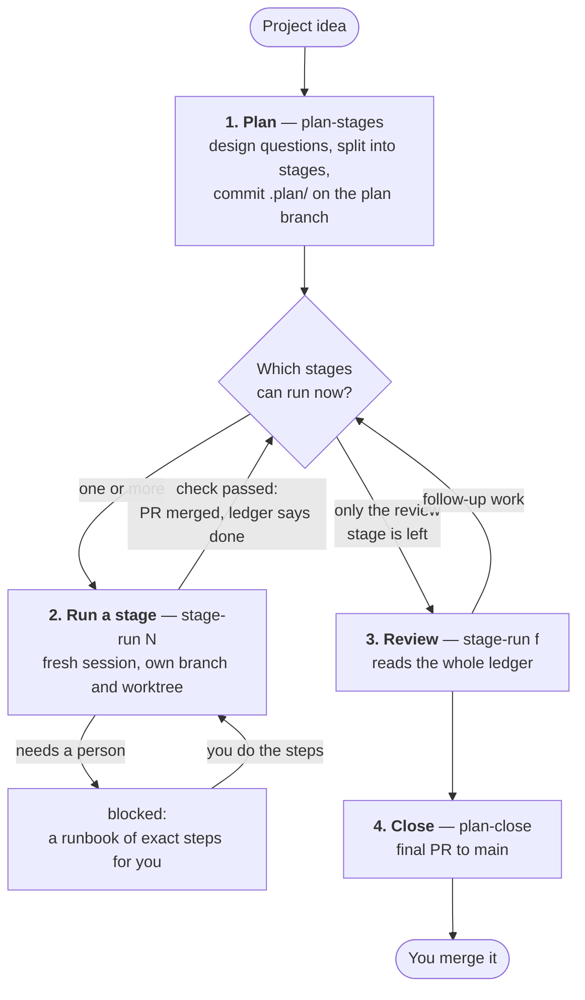
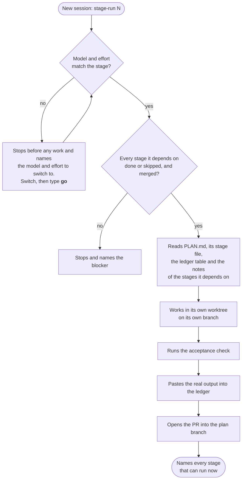
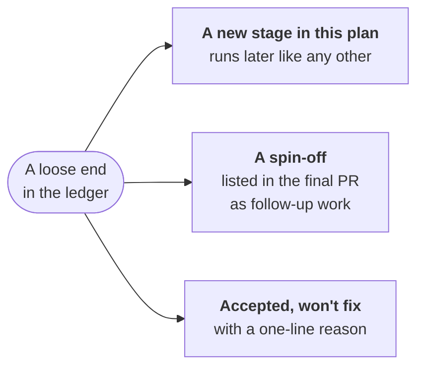
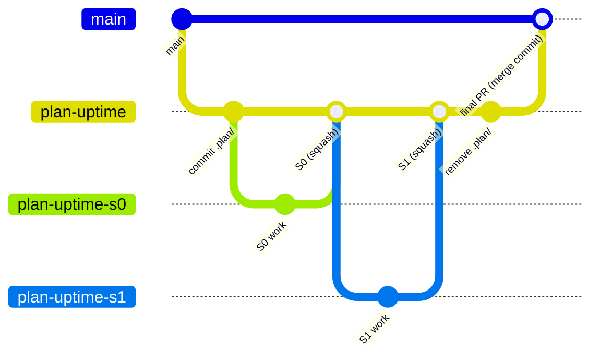

# How a staged rollout works

[Home](../README.md) · [Install](install.md) · **Staged rollout** ·
[Cloud runs](ON-THE-RUN.md) · [Tickets](tickets.md) · [FAQ](faq.md) ·
[Reference](reference.md)

**In short:**

- `plan-stages` turns your idea into a `.plan/` folder of small stages and
  commits it. It runs nothing.
- Each stage then runs in its **own fresh session**, on its **own branch and
  worktree**, and ends with a pull request into the plan branch and proof
  in the ledger.
- A final **review stage** sweeps up loose ends, and `plan-close` opens the
  one PR into `main`. You merge it.



## The steps at a glance

| Step | Command | How often | What happens |
|---|---|---|---|
| 1. Plan | `plan-stages <idea>` | once | Settles the design, splits the work into stages, commits `.plan/`. Runs no stage. |
| 2. Run stages | `stage-run <N>` | once per stage, each in a new session | Does one stage, runs its check, records the output, opens its PR. |
| | `plan-run` | once | The alternative to step 2: runs every remaining stage in the cloud. See [Running a plan in the cloud](ON-THE-RUN.md). |
| 3. Review | `stage-run f` | once, last | Reads every note in the ledger and turns each loose end into a stage or a decision. |
| 4. Close | `plan-close` | once | Writes the final PR from the plan, cleans up and proposes the PR into `main`. |

## What's in `.plan/`

```
<repo>/.plan/
  README.md          # entry point + how to run a stage
  PLAN.md            # architecture, frozen decisions, stage index,
                     #   operating protocol  ← single source of truth
  LEDGER.md          # status table + per-stage as-built notes
  stage-N-<slug>.md  # one thin, self-contained stage each
```

The full list, including `RUNNER.md` and `BLOCKED.md`, is in the
[Reference](reference.md#plan-files).

The operating protocol lives *inside the scaffolded `PLAN.md`*, so a `.plan/`
folder is fully portable: anyone can run a stage with the one-line prompt
"Follow the instructions in `.plan/stage-N-<slug>.md`", even without this
plugin installed. The commands make it easier; they are not a dependency.

To see a filled-in plan before making your own, [`examples/`](../examples/)
holds a complete `.plan/` for a small project captured mid-rollout: a `done`
stage with real acceptance output in the ledger, a `doing` stage with ticked
checkboxes and a handoff note, and a tour of what to notice.

## 1. Plan — `plan-stages <project idea>`

Runs once. If the design isn't settled, it starts with a design pass (using
`superpowers:brainstorming` when installed, or a built-in lightweight
question flow otherwise). The outcome lands directly as **frozen decisions**
in `PLAN.md`, not as a separate spec that would become a second source of
truth. Then it:

- **checks the session's weight first.** Planning is the session that matters
  most, so it requires at least an Opus-class model (read from the session)
  and recommends medium or higher effort (read from `CLAUDE_EFFORT`). It
  offers to stop so you can relaunch with the right settings;
- **splits the work** into the smallest sensible stages with explicit
  `depends`, putting the keystone (the piece everything needs) first as S0;
- **adds a final review stage**, `SF` (see [Review](#3-review--the-final-stage));
- **prints the waves and the critical path** worked out from `depends`, so you
  see before you start which stages can run side by side, and whether the
  plan was accidentally split into one long chain;
- **records the git and worktree model** (a branch and a worktree per stage,
  [below](#branches-and-worktrees)). It is fixed, not a choice you are asked
  to make;
- **commits `.plan/`.** **No stage runs during planning.** It ends by saying
  so and telling you exactly what to run next: the first stage's command and
  its recommended model and effort.

## 2. Run a stage — `stage-run <N>`

Run each stage in a **new session**. The session follows the operating
protocol in `PLAN.md`:



1. **Weight check.** Each stage recommends a model and effort level. A
   session can't switch its own model, so these are honest *launch hints*: the
   model is read from the session itself, the effort from `CLAUDE_EFFORT`.
   On a mismatch the session stops before any work and names the model and
   effort to relaunch with. There is no "continue anyway". A heavier model
   alone is not a mismatch, and an unset `CLAUDE_EFFORT` is reported, not
   treated as one. If you are at the
   keyboard you can switch in place: change the model and effort in the
   session's model menu, then type **go** (or just **.**) and the stage checks
   again and starts.
2. **Read only what's needed.** Frozen decisions, the stage file, the ledger
   table, and the notes of the stages it `depends` on. It never scans the
   repo.
3. **Dependency gate.** If a prerequisite isn't `done` or `skipped` in the
   ledger (and merged into the plan branch), it stops.
4. **Honor `mode`.** `direct`: a one-line plan, then implement. `brainstorm`:
   a design pass scoped to this stage first, treating frozen decisions as
   settled.
5. **Honor `exec`.** `inline`: implement here. `subagent(<model>)`: act as
   orchestrator and hand the implementation to a subagent, so the churn stays
   out of this session's context.
6. **Stay in scope.** It does only this stage. Work spotted for another stage
   is noted in the ledger and left alone; it may become a new stage.
7. **Finish.** Run the acceptance check and record its *real output*; update
   the ledger row and notes; change a frozen decision in `PLAN.md` (and
   nowhere else) if one changed; open the stage PR; then name **every** stage
   that can run now, each with its exact command, its recommended model and
   effort, and whether they can run at the same time. Then stop.

The flags (`mode`, `exec`, `model`, `effort`, `gate`) are explained in the
[Reference](reference.md#stage-flags).

### Stopping halfway

Stage steps are checkboxes. If a session has to stop mid-stage (blocked,
context getting long, or you interrupt it), it marks the stage `doing`, ticks
the completed boxes and writes a handoff note. Running `stage-run <N>` again
(or asking to "run stage \<N> of the plan") resumes from the unticked boxes.

**Statuses:** `todo → doing → done`, plus `blocked` (waiting on a person or
an outside gate: the stage becomes a runbook with exact steps for you) and
`skipped` (decided against, with a one-line reason). A stage left half done is
a normal, resumable state, not a failure. All statuses are in the
[Reference](reference.md#statuses).

### Where a `blocked` record lands

It depends on whether the stage's branch exists yet, and the plan's own
`PLAN.md` states the rule (*Operating protocol → Recording a block*):

- **Before the branch exists** (the weight check, a `gate: human` or
  `gate: local` stop, a refused redo): the record is committed straight onto
  the plan branch, so you can read it the moment it happens.
- **Mid-stage:** the record lands on the stage branch, where its runbook rides
  the stage PR, and is announced on the plan branch through a `### S<N>`
  section in `.plan/BLOCKED.md`. That second write is what makes a mid-stage
  block visible without waiting for a merge.

## Starting the next stage

You don't have to remember where you were. Two things hand you the next
stage.

### Session-start nudge

The real friction of a multi-day rollout isn't typing a long command. It's
that a fresh session doesn't know a rollout exists. A `SessionStart` hook
closes that gap. When the repo has a `.plan/` folder, every new session
starts already knowing every stage that can run: any `doing` stage to
resume, plus every `todo` stage whose `depends` are all `done` or `skipped`.
It shows each one's recommended model and effort from the stage index and
its exact `stage-run` command. When more than one stage can run it says so,
so you see from the first line that they can run side by side. Resuming
becomes "open a session and say yes".

It is deliberately narrow:

- **Silent elsewhere.** No `.plan/` at the repo root → the hook prints
  nothing. It only speaks in a repo with a rollout in progress.
- **It offers, never runs.** Running still belongs to the operating protocol
  in `PLAN.md`: weight check, dependency gate, your go-ahead.
- **Fails silent.** A malformed ledger, missing bash or an ambiguous parse
  means no output and exit 0. A session-start hook must never degrade a
  session.
- **Cross-platform.** The `.cmd` file is a cmd/bash wrapper, so the hook runs
  on Linux, macOS and Windows (via Git Bash). Its one real dependency is
  `bash`. A Windows machine without it simply gets no nudge, and the rest of
  the plugin is unaffected: the commands are run by the model, not by shell
  scripts.

### From a chip in the desktop app

In the **Claude desktop app**, a finished stage also offers each next stage
as a **suggestion chip**, so you click instead of pasting the command into a
new session. Click the chip (top right of the window) and choose **Start
locally**:

| Launch mode | Use it? |
|---|---|
| **Start locally** | **Yes.** Runs in your clone, which the stage leaves on the plan branch while it works in its own worktree. |
| Start with worktree | Works, but the app's worktree is based on the default branch, so the stage ignores it and makes its own; the app's one is left behind unused. |
| Send to cloud | Works for a plan with `.plan/RUNNER.md`, but **may use additional credits**, and refuses a `gate: local` stage. For cloud runs, use [`plan-run`](ON-THE-RUN.md). |
| Fix in this session | **No.** It lands in the finished stage's session instead of a fresh one; the stage refuses to start there. |

- **The chip usually starts on the finishing session's model and effort**,
  not the stage's. A `spawn_task` chip has no way to set them, and a
  `start_session` card can only set them *at or below* the finishing
  session's. When the next stage asks for the same weight (or lighter, via
  `start_session`) it runs straight through. When not, it stops before any
  work and tells you what to switch to: switch in the model menu and type
  **go**.
- **Two chip tools exist, and a session may have only one.** Some desktop
  sessions offer `spawn_task`, others `start_session`; the stage uses
  whichever is there. A `start_session` card starts with a click, or by
  telling Claude "start it".
- **No chip on a phone.** Following the session over Remote Control, or
  working in a terminal, shows no chip: paste the printed command into a
  fresh session instead. The printed command is always there; the chip is an
  addition, never a replacement.

## 3. Review — the final stage

Planning always adds `SF: plan review` (run it with `stage-run f`, or ask to
"run the review stage"). It is the one stage allowed to read the *entire*
ledger: every note, gotcha, shortcut and known gap from every stage. It
sweeps for anything left loose. **It lists; it never implements.** Each
finding becomes exactly one of three things:



- **A new stage in this plan**, for follow-up work that belongs to this
  project (a shortcut to reconcile, a config to bring under management). It
  gets a stage index row in `PLAN.md` (with its flags), a ledger row and a
  stage file, and runs later as a normal `stage-run <N>` in its own fresh
  session and branch.
- **A spin-off**, for work that has outgrown this plan (a genuinely new
  project). It is recorded in the ledger and listed in the final PR body as
  follow-up work. It does not block closing. Start it later with its own
  `plan-stages`.
- **An explicit "accepted, won't fix"**, with a one-line reason, so the gap
  is a decision instead of a surprise.

Its acceptance check: every loose end in the notes is either a new ledger row
or explicitly closed.

## 4. Close — `plan-close`

It refuses to run until every ledger row is `done` or `skipped` (including
the stages the review added), and `.plan/BLOCKED.md` holds no leftover
`### S<N>` section from a stage later resolved by hand. Nothing clears that
file automatically, so closing checks it instead of trusting the ledger
alone. Then it:

1. turns `PLAN.md` and the ledger into the final PR body, so the *why* and
   the as-built story survive on `main`;
2. removes the stage worktrees that are finished (branch merged, nothing
   unpushed), and stops on any that still holds work git cannot recover;
3. deletes `.plan/` as the last commit on the plan branch. Nothing is lost:
   the full plan history stays in git. To keep the folder, for a project
   where the plan doubles as documentation, set `plan-dir: keep`;
4. proposes the PR from `plan-<slug>` to `main`. You review and merge it.

It runs unattended too: `plan-close --unattended` applies the plan flags
instead of asking, and a [cloud-run plan](ON-THE-RUN.md) can run it as one
more fired session once every stage is settled. **Merging that final PR is
always yours.**

## Branches and worktrees

Every plan uses the same fixed model: a plan branch off `main`, and one branch
per stage off the plan branch.



Each stage PR is **squash-merged** into the plan branch, so each stage is one
commit there. The final PR into `main` is a **normal merge**, so each stage
lands on `main` as its own commit, while `git log --first-parent main` still
shows one merge per project.

On disk, that means your clone plus one sibling folder per running stage:

```
~/src/
  myrepo/        ← your clone, always on plan-<slug>, holds .plan/
  myrepo-s1/     ← worktree, branch plan-<slug>-s1
  myrepo-s3/     ← worktree, branch plan-<slug>-s3   (running at the same time)
```

The rules:

- **Every stage gets its own branch and PR into the plan branch**, no
  exceptions. Uniformity is the point: each unit stays reviewable on its own,
  and it prevents the classic failure where "one small commit" quietly
  becomes twenty commits of fixes bleeding into shared history.
- **Branch names are flat** (`plan-<slug>-s3`, not `plan/<slug>/s3`) because
  git can't nest a branch under an existing branch name.
- **Branch plumbing is automatic; merging is not.** The agent creates and
  pushes stage and plan branches without asking, and opens the stage PR as a
  required part of finishing a stage. Merges are **offered** and happen only
  on your OK. It never merges on its own and never pushes to `main`. The one
  exception is a plan that sets `merge: auto` (see the
  [plan flags](reference.md#plan-flags)): that is your OK given in advance
  for **stage PRs only**, so the session squash-merges its own stage PR once
  checks are green. The plan→main PR stays yours in every mode. A stage
  can't be marked `done` until its PR is merged.
- **Repo settings needed:** the GitHub repo must allow both squash merging and
  merge commits. Recommended defaults: squash message = "Pull request title
  and commit details"; merge-commit message = "Pull request title and
  description" (so the final PR body lands in the merge commit on `main`).
- **Set the repo's default merge button to "Create a merge commit".**
  Nothing enforces the merge type at the final merge. It is the one step no
  session performs, so it is also the one step the plan can't police:
  whoever merges gets whatever the default button offers. A default of
  "Squash and merge" silently collapses every stage into a single commit on
  `main`. The result looks fine (the PR is merged, the files are there) but
  the per-stage history is gone. It is easiest to hit from a phone, where the
  button is tapped without opening the dropdown. Closing writes the required
  merge type into the final PR body for exactly this reason, but a line in a
  PR body is a reminder, not a control.
- **The clone never leaves the plan branch.** *The clone holds the plan;
  worktrees hold the work.* A stage branch is checked out only in its own
  sibling worktree (`../<repo>-s<N>`), created from the plan branch tip when
  the stage starts and removed after its PR merges. So `.plan/` is readable
  in the clone at every moment, and the `done` write needs no checkout. A
  stage worktree that still holds uncommitted or unpushed work is left alone
  and reported, not removed; every later stage flags it, and closing stops
  on it. A worktree that is merely *left over* (branch merged, nothing
  unpushed) is cleared by closing instead of blocking it.
- **A fresh worktree has only tracked files.** Untracked local setup a stage
  needs (`.env`, local config, caches, dependency folders) has to be copied
  in. The stage does that and records what it copied in the ledger.
- **This is the only supported model.** A branch per stage and a worktree per
  stage are both recorded as frozen decisions during planning, not offered as
  choices.

## Running stages in parallel

`depends` is a real dependency graph, so a plan often has several stages that
can run at the same time. Everything that answers "what's next" reports the
whole **runnable set** (every `todo` stage whose dependencies are met), never
just the first:

```
3 stages are runnable right now — none depends on another, so they can be
run concurrently, one per fresh session:

- S1 — Parser       /stage-run 1   (model sonnet, effort low)
- S2 — Renderer     /stage-run 2   (model sonnet, effort med)
- S3 — CLI flags    /stage-run 3   (model haiku,  effort low)
```

Planning prints the waves and critical path for the same reason: the number of
waves is the fewest rounds the plan can take, and the critical path is the
minimum elapsed time that no amount of parallel work removes.

Two deliberate limits:

- **Waves are worked out, never stored.** There is no `wave` or
  `parallel-group` column in the stage index. Waves are a view of `depends`,
  and a stored copy of a single source of truth is exactly what this method
  exists to prevent.
- **Launching is yours.** Running a wave in parallel means one session per
  stage: one [chip](#from-a-chip-in-the-desktop-app) click each in the
  desktop app, or one terminal each elsewhere. The plugin tells you what
  *can* overlap; whether to is your call. The
  [cloud orchestrator](ON-THE-RUN.md) takes the keyboard out of *one after
  another* runs, not this: it runs a multi-stage runnable set one stage at a
  time.

What makes this safe is the worktree per stage: each session works in its own
folder on its own branch, so nothing fights over a checkout and no session
can see another's uncommitted work. Four more rules keep the branches from
colliding when they meet at the plan branch:

- **The plan branch is where they meet, one at a time.** Stage PRs merge one
  at a time, first come first served. Whoever merges second re-syncs: merge
  the plan branch *into* the stage branch, resolve there, and **run the
  acceptance check again**, because "mergeable" means no text conflict, not
  that the stage still passes after the sibling's change. Squash merging makes
  that free, which is why stage branches are never rebased or force-pushed.
- **Another stage's branch is not drift.** A stage's preflight check reads a
  `todo` row with a committed stage branch as a crashed session, but only
  stops when it is *its own* stage. Another stage's branch in progress is
  reported and stepped over, so parallel sessions don't stop each other.
- **Writing the same files is a `depends` edge.** Two stages that write the
  same files are not independent, whatever the feature graph says. There is
  no separate field for this (a second record of one constraint is a second
  thing to drift), so planning checks for the overlap and adds the edge.
- **The `done` ledger write can race.** Both sessions commit it directly on
  the plan branch: edit after the fast-forward, replay with a rebase if the
  push is rejected, keep both rows on conflict, and never force-push the plan
  branch.

**Subagents are not a substitute.** Running a whole wave from one session via
`exec: subagent(<model>)` avoids git concurrency, but it collapses N stages
into one branch, one PR, one ledger row and one acceptance check. The
orchestrating session also collects every subagent's result, so its cost stops
being flat, and flat cost per session is what this whole method rests on. Use
subagents *within* a stage for churn. If a wave really is one unit of work,
merge those stages when you split the plan instead.
