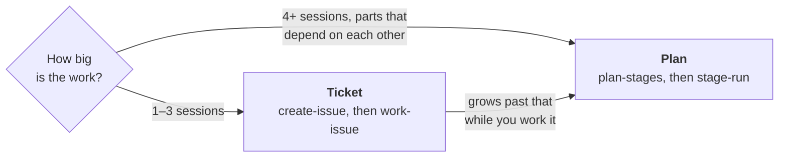
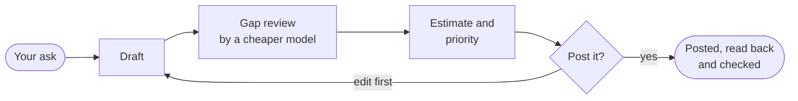
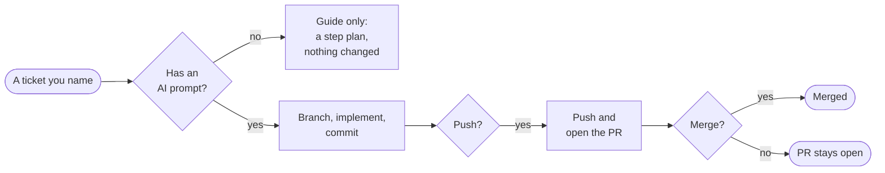

# Tickets — `create-issue` and `work-issue`

[Home](../README.md) · [Install](install.md) · [How it works](staged-rollout.md) · [Cloud runs](ON-THE-RUN.md) · **Tickets** · [Ticket template](ticket-templates.md) · [FAQ](faq.md) · [Reference](reference.md) · [Why](why.md)

**In short:** two skills for work smaller than a plan, one GitHub issue or
one Jira ticket at a time. `create-issue` writes a ticket and posts it only
after you approve. `work-issue` works a ticket you name: if the ticket has an
**AI prompt** section, Claude implements it; without one, Claude only guides
you. Nothing is posted, pushed or merged without your yes.

A ticket's acceptance criteria are its gate and its AI prompt is the
instruction. A plan's stages are not tickets, and nothing links them to
tickets yet. If a ticket grows past three sessions while you work it, stop
and start a plan with the ticket as its origin rather than stretching one
branch across days.

## Write a ticket — `create-issue`

Say "create an issue for …", "draft a Jira story for this" or "write this up
as a GitHub issue", or run `/plan-staged-rollout:create-issue`.

1. **Gather.** It works out the tracker and the target repo or project (the
   current repo by default) and reads what you point it at: a thread, a
   document, an error. It searches for duplicates and shows any likely match.
2. **Floor test.** If the work is tiny and in a repo this session can change,
   it offers to just do it instead. If the outcome, the reason or the place
   is missing, it asks for all of them in one message rather than inventing
   them.
3. **Draft.** The default body is *In plain terms / Context / Out of scope /
   Acceptance Criteria*, plus an optional *AI prompt*.
4. **Gap review.** A cheaper Sonnet-tier reviewer checks the draft against
   your material and a fixed checklist.
5. **Estimate.** It proposes a size or story points and a priority, each with
   its reason. It may propose a time-boxed spike or a split instead.
6. **Preview.** It shows the ticket as it will land and asks **Post it?** You
   can post, edit first, or not post.
7. **Post and read back.** It posts through the tracker, reads the ticket
   back, compares every field and repairs a mismatch once.

**Dry run:** say "dry run", "don't post" or "just draft" (it also runs as one
when the tracker's adapter isn't available). It does steps 1–5, shows the
preview without asking **Post it?**, and says plainly that nothing was
posted.

## Work a ticket — `work-issue`

Say "work issue 124" or "work WID-120", or run
`/plan-staged-rollout:work-issue <ticket>`. It only starts when you name a
ticket; it never starts on its own. The ticket doesn't have to come from
`create-issue`.

| Say | Or type | It does |
|---|---|---|
| "work issue 124" | `work-issue 124` | Works that ticket: a GitHub number, `owner/repo#124`, a URL, or a Jira key |
| | `work-issue 124 <base>` | Same, landing the work in the base branch you name |
| "resume issue 124" | `work-issue 124 --resume` | Continues the ticket's existing branch and open pull request |
| "work 124 after 123" | `work-issue 124 --after 123` | Waits for issue 123 to close (up to 24 hours, session kept open), then works 124. GitHub only; [details](#waiting-on-another-ticket). |

**The AI prompt decides what happens.** There is no other switch:

- **With an AI prompt:** it reads the ticket and its thread, checks the
  session's model and effort against the ticket's recommendation, creates a
  branch, implements, commits and opens a pull request. If the prompt leaves
  the repo or base branch unclear, it asks once.
- **Without one:** guide only. You get an interpretation, a step plan with a
  check for each step, and what the ticket needs to become actionable. No
  branch, no commit, no comment.

**What asks you first:**

| Step | Asks? |
|---|---|
| Posting a comment on the ticket | **Post it?** |
| Pushing, opening the PR and linking it from the ticket | **Push?** (one yes for all three) |
| Merging | **Merge?**, always its own question, after a gap check and, when there is something a person can check, a verification step |
| Status changes your template sets (for example, to in-progress) | No: naming the ticket authorizes them |
| The blocked-by link that `--after` records | No: same reason |

After a merge, it lists any tickets that were waiting on this one and are now
free.

It works in your current clone: one branch per ticket, no worktree unless you
ask, never a commit to the default branch, never a force-push.

### Waiting on another ticket

`work-issue 124 --after 123` records 124 as blocked by 123, then watches 123
from this session for up to 24 hours (keep the session open). If 123 closes
as completed, it works 124; if it closes as not planned, it asks first. After
24 hours it stops without re-arming. GitHub only, and 123 must be an issue,
not a pull request.

## Trackers and requirements

- **GitHub** goes through `gh`. **Jira** goes through the Atlassian MCP server
  (v1 or v2, detected at runtime).
- The scripts need **Python 3.11 or later**, standard library only.
- A `PreToolUse` hook, `gh-body-guard`, blocks the `gh` command shapes that
  silently corrupt an issue body containing non-ASCII characters. It runs
  through `bash`, like the session-start nudge.

## Your team's ticket format

**Team conventions are a template, not a fork.** With no configuration, the
built-in default applies. To use your own, write a small TOML file that
extends the default and point `ticket_template` at it, for yourself or for a
whole repo. A template can set the sections, the story-point matrix, guarded
fields, board routing and the merge command. Keep your organization's field
ids and names in a private template file, not in a public repo.

Step by step: [Customizing the ticket template](ticket-templates.md). Every
field: [`tickets/references/template-schema.md`](../tickets/references/template-schema.md).
