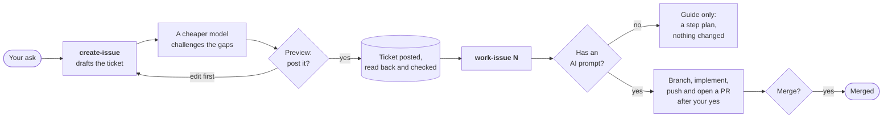
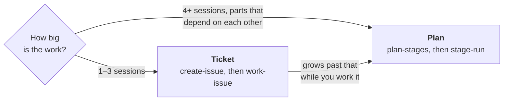

# Tickets — `create-issue` and `work-issue`

[Home](../README.md) · [Install](install.md) · [Staged rollout](staged-rollout.md) ·
[Cloud runs](ON-THE-RUN.md) · **Tickets** · [FAQ](faq.md) ·
[Reference](reference.md)

**In short:** two skills for work smaller than a plan, one GitHub issue or
one Jira ticket at a time.

- **`create-issue`** writes one well-formed ticket and posts it only after you
  approve it.
- **`work-issue`** works one ticket you name. If the ticket has an **AI
  prompt** section, Claude implements it and opens a pull request. Without
  one, Claude only guides you. Nothing is pushed, posted or merged without
  your yes.

## Write a ticket — `create-issue`

Say "create an issue for …", "draft a Jira story for this" or "write this up
as a GitHub issue", or run `/plan-staged-rollout:create-issue`.

What happens:

1. **Gather.** It works out the tracker and the target repo or project (the
   current repo by default) and reads what you point it at: a thread, a
   document, an error. It searches for duplicates and shows any likely match.
2. **Floor test.** If the work is tiny and in a repo this session can change,
   it offers to just do it instead. If the outcome, the reason or the place
   is missing, it asks for all of them in one message rather than inventing
   them.
3. **Draft.** The default body is *In plain terms / Context / Out of scope /
   Acceptance Criteria*, plus an optional *AI prompt*.
4. **Gap review.** A cheaper Sonnet-tier reviewer challenges the draft against
   your material and a fixed checklist.
5. **Estimate.** It proposes a size or story points and a priority, each with
   its reason. It may propose a time-boxed spike or a split instead.
6. **Preview and approve.** It shows the ticket as it will land and asks
   **Post it?** You can post, edit first, or not post.
7. **Post and read back.** It posts through the tracker, reads the ticket
   back, compares every field and repairs a mismatch once.

**Dry run:** say "dry run", "don't post" or "just draft". It does steps 1–6
and stops at the preview, saying plainly that nothing was posted.

## Work a ticket — `work-issue`

Say "work issue 124" or "work WID-120", or run
`/plan-staged-rollout:work-issue <ticket>`. It only starts when you name a
ticket; it never starts on its own.

| Say | Or type | It does |
|---|---|---|
| "work issue 124" | `work-issue 124` | Works that ticket: a GitHub number, `owner/repo#124`, a URL, or a Jira key |
| | `work-issue 124 <base>` | Same, landing the work in the base branch you name |
| "resume issue 124" | `work-issue 124 --resume` | Continues the ticket's existing branch and open pull request |
| "work 124 after 123" | `work-issue 124 --after 123` | Waits until GitHub issue 123 closes, then works 124. GitHub only. |

**The AI prompt decides what happens.** There is no other switch:

- **With an AI prompt:** it reads the ticket and its thread, checks the
  session's model and effort against the ticket's recommendation, creates a
  branch, implements, commits and opens a pull request. If the prompt
  leaves the repo or base branch unclear, it asks once.
- **Without one:** guide only. You get an interpretation, a step plan with a
  check for each step, and what the ticket needs to become actionable. No
  branch, no commit, no comment.

**Every outward step waits for your yes:** posting a comment (**Post it?**),
the push and its pull request (**Push?**), and the merge (**Merge?**, always
its own question). Before the merge question it runs a gap check, plus an
acceptance check when there is something a person can verify. After a merge,
it lists any tickets that were waiting on this one and are now free.

It works in your current clone: one branch per ticket, no worktree unless
you ask, never a commit to the default branch, never a force-push.

## Trackers and requirements

- **GitHub** goes through `gh`. **Jira** goes through the Atlassian MCP server
  (v1 or v2, detected at runtime).
- The scripts need **Python 3.11 or later**, standard library only.
- A `PreToolUse` hook, `gh-body-guard`, blocks the `gh` command shapes that
  silently corrupt an issue body containing non-ASCII characters.

## Your team's ticket format

**Team conventions are a template, not a fork.** With no configuration, the
built-in default template applies. To use your own, set `ticket_template`
in `$CLAUDE_CONFIG_DIR/plan-staged-rollout.toml` (falling back to
`~/.claude/plan-staged-rollout.toml`). A `<repo>/.claude/plan-staged-rollout.toml`
overrides it key by key. The value is a path, or a table
`{ github = "...", jira = "..." }` when you use both trackers. A template
that is missing or invalid gives one notice, then the default applies.

A template can set the sections, the story-point matrix, guarded fields,
board routing and the merge command; the full list is in
[`tickets/references/template-schema.md`](../tickets/references/template-schema.md).
Keep your organization's field ids and names in a private template file, not
in a public repo.

New to this? Start with
[Customizing the ticket template](ticket-templates.md).

## Ticket or plan?

- **One ticket, one to three sessions of work** → `work-issue`. The ticket's
  acceptance criteria are the gate and its AI prompt is the instruction.
- **Four or more sessions, with dependencies and a design worth freezing** →
  start a plan with `plan-stages`. A plan's stages are not tickets, and
  nothing links them to tickets yet.
- **A ticket that grows past that while you work it** → stop and start a
  plan, with the ticket as its origin. Don't stretch one branch across days.
