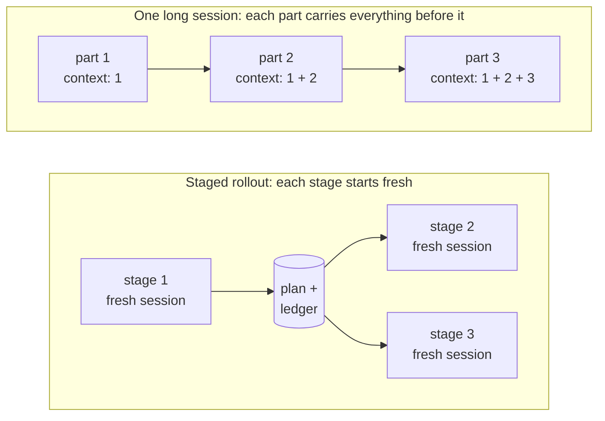

# Why staged rollouts

[Home](../README.md) · [Install](install.md) · [How it works](staged-rollout.md) · [Cloud runs](ON-THE-RUN.md) · [Tickets](tickets.md) · [Ticket template](ticket-templates.md) · [FAQ](faq.md) · [Reference](reference.md) · **Why**

**In short:** one long session for a big build gets expensive, drifts, hides
its progress and is hard to undo. Making each *session* small, with the plan
and the proof written down in the repo, fixes all four.

## The problem

When you hand an AI a project that is too big for one sitting, the usual
outcome is a single monster session (or a monster plan executed in one):

- **Context blows up.** The window fills with file reads, tool output, and
  dead ends. Compaction re-summarizes it lossily, again and again. Token cost
  grows with everything that came *before*, not with the task at hand.
- **The plan drifts.** Decisions get restated in prompts, plans, and replies.
  Copies diverge; three weeks in, nobody knows which version is true.
- **Progress is opaque.** "Where were we?" means re-reading a transcript.
  There is no glanceable state, and "done" means the model *said* it was done.
- **Undo is surgery.** Everything landed as one tangle of commits (or none).
  Rolling back the last piece of work means picking it apart by hand.

Planning workflows (brainstorming skills, plan mode, spec-driven setups) help
you produce a *good plan* — but they still hand you one big artifact to
execute in one big run.

## The idea

Invert it. Make the *session* the unit of work, and make it small:

1. **Decompose once** into the smallest sensible stages, each with explicit
   dependencies, written as thin files in a `.plan/` folder.
2. **One fresh session per stage.** Each session reads only the frozen
   decisions, its stage file, and a slim ledger — never the whole history.
   Context cannot accumulate across stages because sessions don't share it.
3. **One source of truth.** All durable decisions live in `PLAN.md` and are
   *referenced, never copied*. A decision that exists in one place cannot
   diverge.
4. **An evidence ledger.** A stage is done when its acceptance check *ran* and
   the real output is recorded — not when the model claims success.
   `LEDGER.md` is both the resume point and the cross-session memory.
5. **A branch per stage, in a worktree per stage.** Each stage lands as its
   own PR into the plan branch. Reviewing is small, undoing is a branch
   delete, and one stage's "quick fix" can never contaminate another's
   history. Your clone stays parked on the plan branch the whole time — the
   work happens in sibling worktrees, so the ledger is always in front of you
   and two stages can run at once without fighting over a checkout.

Sessions stay cheap, the plan stays true, progress stays visible, and you can
stop and resume whenever you have time.

## What you get

| Goal | Mechanism |
|---|---|
| **Token reduction** | A fresh session per stage reads only `PLAN.md`, its stage file and the ledger table, so each stage costs about the same however many came before. No compaction spiral. |
| **Tracking** | Ledger with fixed statuses and pasted acceptance evidence. "Where were we?" is a one-line-per-stage table, not a transcript. |
| **Control** | Sessions stop at stage boundaries. You choose pace and order; PR-per-stage gives you an acceptance gate on every unit. Human-gated work becomes an explicit `blocked` + runbook, never faked progress. |
| **Versioning / undo** | Undo a stage by discarding its branch before its PR merges, or by redoing it on a fresh branch after. `main` gets one commit per stage. Details: [How do I undo a stage?](faq.md#how-do-i-undo-a-stage) |

## When *not* to use this

- **Work that fits in one to three sessions.** The scaffold has a floor cost;
  below roughly four sessions of work, just do the work.
- **Exploratory work with no settleable design.** If every session would
  legitimately rewrite the frozen decisions, there is nothing to freeze yet.
- **Work that can't be decomposed.** One giant inseparable step gains nothing
  from a ledger around it.

And two honest limits even when it fits: decomposition quality gates
everything (bad stage boundaries cause cross-stage churn no protocol fixes —
though the review stage catches what leaks), and fresh sessions only know what
was written down (a long session carries tacit context; here, note discipline
replaces it).

## How it compares

| | This plugin | Nearest neighbors |
|---|---|---|
| Plan execution | Fresh session per stage; flat token cost | superpowers `writing-plans`/`executing-plans`, plan mode: one plan document, executed in one session lineage |
| Phase separation | Stages with dependencies, resumable in any valid order | GSD-style plan/execute/verify: separate sessions, but coarse phases, no ledger |
| Cross-session state | Evidence ledger + frozen decisions, plain Markdown in-repo | Continuity-ledger / handoff tools: aimed at continuing *one* task across resets |
| Task tracking | No external tooling; git is the database | spec-kit, task-master, beads: capable, but CLIs/MCP servers/issue graphs to install and learn |

None of the neighbors combine **session-per-stage + evidence ledger +
single-source frozen decisions + per-stage weight knobs** — and the
differentiators here are principles encoded in Markdown, not tooling you have
to adopt. It composes with what you already run: superpowers handles the
within-session process (brainstorming, TDD, verification); this handles the
cross-session structure.

Two pages go deeper: [Pairing with superpowers brainstorming](superpowers-brainstorming.md)
says what to do with the spec brainstorming writes, and
[Single session or many](single-vs-multi-session.md) compares running a build
in one session with running it as stages.

## Anti-patterns this exists to prevent

- Restating decisions in prompts or stage files (copies drift — point at
  `PLAN.md`).
- One giant stage (blows context, can't resume — split it).
- Brainstorming everything (design ceremony on mechanical work — `direct` is
  the default).
- Subagents everywhere (session-per-stage already isolates context — reserve
  them for churn).
- Claiming done without evidence (the acceptance output must actually land in
  the ledger).
- Silent scope creep ("while I'm here…" — note it, spin a stage, move on).
- Skipping the dependency gate (building on an unbuilt prerequisite).

## Provenance

Distilled from a real multi-day homelab rollout (centralized logging + AI
analysis, 8 stages) executed manually with this method before it became a
plugin. That run is where the lessons come from: the ledger diet, the
`blocked`-stage runbook pattern, follow-up stages born from shortcuts, and a
later stage catching a regression an earlier stage introduced — because the
earlier stage's assumptions were written down.

## Roadmap

- Parallel waves in the cloud orchestrator (it runs one stage at a time today)
- Subagent fan-out for independent sub-steps within a stage
- Progress dashboard rendered from the ledger
- Skill evals (triggering accuracy, protocol adherence)
