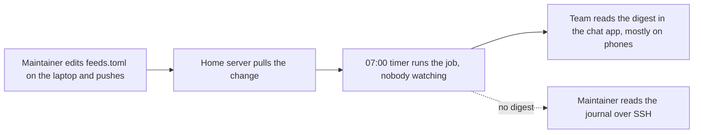
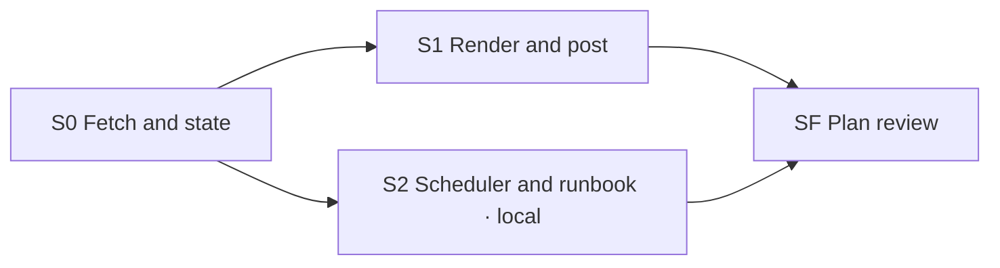

Generated from PLAN.md @ 93a8b7e4f1b9 — do not edit
# feed-digest — plan brief

> One page to check this plan against what you expect. Feedback goes in chat
> (or as comments on the artifact): it is applied to `PLAN.md`, and this brief
> is regenerated from it.

## Outcome

*From `PLAN.md` › Requirements › Outcome.*

One message in the team channel each morning with every new post from the
feeds we follow, so nobody has to check them by hand and nothing is posted
twice.

## Day to day

*From `PLAN.md` › Requirements › Day to day.*

## Constraints and out of scope

*From `PLAN.md` › Requirements › Constraints and Out of scope.*

**Constraints, ranked:**

1. Never post the same entry twice, even when a run is repeated by hand.
2. The webhook URL is a secret — it never reaches the repository or a log.
3. One dependency at most beyond the standard library.
4. A failed run must be visible from the journal without reading code.

**Out of scope:** a web UI for managing feeds; per-person digests; email
delivery.

## Decisions

*From `PLAN.md` › Frozen decisions and Plan review.*

| ID | Decision | Group | Status |
|---|---|---|---|
| D-1 | Python 3.11, `feedparser` the only dependency | Decided | feed formats are too irregular to parse by hand |
| D-2 | Deliver through a chat incoming webhook | Needs you | answered — not email, not a bot account |
| D-3 | Webhook URL only from `FEED_DIGEST_WEBHOOK` | Decided | added by the plan review; `feeds.toml` is committed |
| D-4 | Dedupe by a stable entry key in SQLite, recorded after a successful post | Needs you | answered — not JSON, not a time window |
| D-5 | Daily systemd timer, no retry loop | Default for now | revisit after two weeks of real runs |
| D-6 | Cap a digest at 30 entries, then "+N more" | Default for now | revisited at S1: kept |
| D-7 | No decision record exists; close creates `DECISIONS.md` | Decided | bootstrap found no ADR folder or decisions doc |

**Plan review lenses:** Simplicity — always on; Security — a secret (the
webhook URL), untrusted feeds over the network, and a new dependency (S0);
Operator — the product runs unattended on a daily timer (S2). Architect off:
one component, no shared interface. Five findings: three changed the plan,
one follow-up (#41), one accepted.

## Done when

*From `PLAN.md` › Requirements › Done.*

- [ ] `pytest` passes.
- [ ] `feed-digest run --dry-run` against the fixture feeds prints one digest;
  a second run prints "no new entries".
- [ ] `systemctl list-timers feed-digest.timer` shows the next run on the
  server.
- [ ] `RUNBOOK.md` covers "the digest did not arrive".

## Stage map

*From `PLAN.md` › Stage index & dependencies.*

