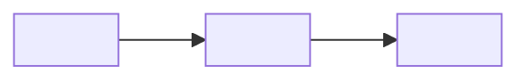
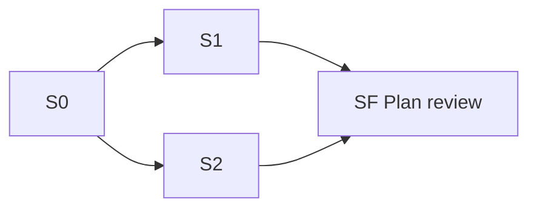

Generated from PLAN.md @ <hash> — do not edit
# <Project name> — plan brief

<!-- Generation rules (drop these comments from the generated file):
- Line 1 is the stamp, exactly as above. <hash> is the first 12 hex characters
  of `git hash-object .plan/PLAN.md`, taken from the PLAN.md the brief was
  generated from. A brief whose stamp differs from PLAN.md's current hash is
  stale and is regenerated before anyone reads it.
- This file is written to `.plan/BRIEF.md` and tracked on the plan branch.
  Where the Artifact tool exists, the same content is also published as an
  artifact; the file is the brief, the artifact only renders it.
- Every section is generated from PLAN.md and names its source section in the
  italic line under its heading. Never add content PLAN.md does not hold: if
  the brief needs something, it goes into PLAN.md first.
- Hand edits are overwritten at the next regeneration, by design. Whoever
  edits PLAN.md regenerates this file in the same commit.
- One page: aim for under ~100 lines. Plain language — no protocol detail. -->

> One page to check this plan against what you expect. Feedback goes in chat
> (or as comments on the artifact): it is applied to `PLAN.md`, and this brief
> is regenerated from it.

## Outcome

*From `PLAN.md` › Requirements › Outcome.*

<The outcome in the user's own words, two or three sentences.>

## Day to day

*From `PLAN.md` › Requirements › Day to day.*

## Constraints and out of scope

*From `PLAN.md` › Requirements › Constraints and Out of scope.*

**Constraints, ranked:**

1. <Constraint — the one that wins a conflict.>
2. <Constraint.>

**Out of scope:** <item>; <item>.

## Decisions

*From `PLAN.md` › Frozen decisions and Plan review.*

| ID | Decision | Group | Status |
|---|---|---|---|
| D-1 | <the decision, one line> | Needs you | <answered / pending — blocks S2> |
| D-2 | <the decision, one line> | Decided | <reason in a clause> |
| D-3 | <the decision, one line> | Default for now | <revisit when …> |

<!-- One row per frozen decision, in PLAN.md's order. Fixed protocol entries
(Git strategy, Worktree strategy, Final review stage) are left out. -->

**Plan review lenses:** <Lens> — <trigger that fired>; <Lens> — <trigger>.
<Or, before the review has run: "not run yet".>

## Done when

*From `PLAN.md` › Requirements › Done.*

- [ ] <A check a script or a person can run.>
- [ ] <Check.>

## Stage map

*From `PLAN.md` › Stage index & dependencies.*

<!-- One node per stage, one edge per `depends` entry. Mark a `gate: human`,
`gate: local` or `gate: live` stage in its label, e.g. `S3[S3 <name> · human]`
or `S4[S4 <name> · live]`. -->
